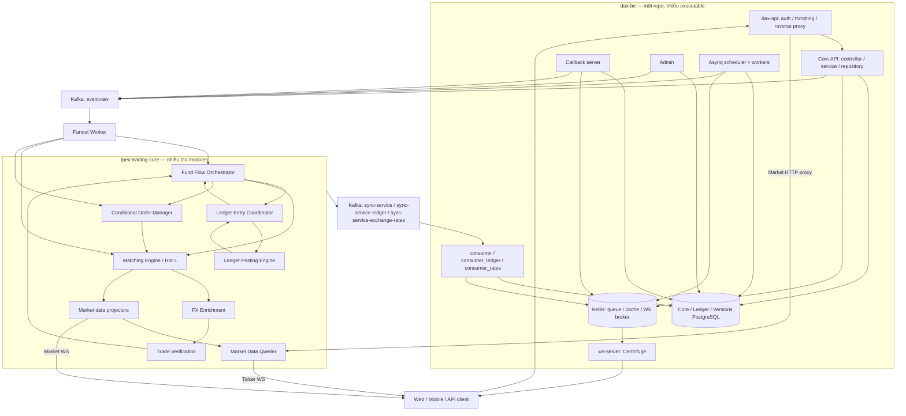
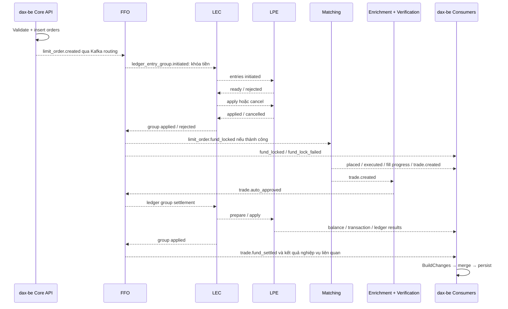

# Mô hình chi tiết: dax-be ↔ lpex-trading-core

Khảo sát source ngày **30/10/2026**, dựa trên các snapshot đã lấy bằng GitHub CLI trong phiên này:

- `dax-be/main`: `778975ac8466a3381d08c94f3296c81997b1b0c5`.
- `lpex-trading-core/master`: `138dfcd1cfaae845ef0f2a77a934c58011129b45`.

Các dẫn nguồn ghim theo hai commit trên. Đây là mô hình implementation trong source; chưa kiểm tra release/pod/config override đang chạy. Các ví dụ số học bên dưới dùng số giả định và lược bỏ phí/thuế khi có ghi chú.

## 1. Hai repo tạo thành mô hình gì?

**`dax-be` là lớp ứng dụng giao dịch; `lpex-trading-core` là tập engine xử lý matching và tài chính bằng event.** Quan hệ giữa chúng là command → asynchronous processing → projection, kèm một nhánh query market data bằng HTTP.

| Khía cạnh | dax-be | lpex-trading-core |
|---|---|---|
| Đầu vào chính | HTTP từ client/admin/partner, Kafka kết quả | Kafka business events, giá thị trường, setting/heartbeat |
| Đối tượng quản lý | User, auth/session, yêu cầu nghiệp vụ, workflow, projection, admin | Order book, pending financial operation, ledger group/entry, account state, market projection |
| Nơi quyết định | Có cho phép nhận yêu cầu và thực hiện bước workflow phía app không | Có đủ tiền, có khớp lệnh, áp dụng bút toán nào, kết quả engine |
| State chính | PostgreSQL qua repository/GORM; Redis/cache | State trong RAM của partition/shard + event log + snapshot |
| Output | HTTP response, Kafka command events, HTTP partner calls, realtime | Kafka result events, NATS, market HTTP/WS, persistence phụ trợ |
| Kiểu tổ chức code | Một Go module build nhiều executable; business code dùng chung | Go workspace nhiều module/service; dùng chung runtime và event schema |
| Scale | Gateway/API/worker/consumer theo workload | Theo consumer group, partition, shard và mapping symbol |

Các nhãn kiến trúc dưới đây là **nhận định từ cấu trúc code**, không phải toàn bộ tên gọi chính thức của dự án:

- Backend có đặc điểm **modular application với nhiều process**: các process khởi tạo chung services/repositories, dùng các database tương ứng của backend.
- Trading core là **stateful event-driven services**: handler biến input event và state hiện tại thành state mới cùng output events.
- Đường giao dịch có đặc điểm **CQRS**: engine xử lý command, backend cập nhật các projection cho truy vấn. Tuy nhiên, backend vẫn tạo order/request record và xử lý business writes; không phải toàn bộ backend chỉ đọc.
- Ledger coordination có đặc điểm **hai pha prepare/apply qua event**, không phải một SQL transaction hay Kafka transaction bao trùm mọi service.

## 2. Sơ đồ các process thực sự tương tác



Mũi tên giữa các engine biểu diễn giao tiếp **qua Kafka routing**, không phải gọi hàm trực tiếp. Trong backend, callback/admin/worker tạo services riêng từ cùng business code; chúng không gọi xuyên process tới object của Core API. Mỗi process truy cập database/infrastructure theo dependencies được khởi tạo trong entrypoint.

Nguồn: [Process definitions](https://github.com/remitano/dax-be/blob/778975ac8466a3381d08c94f3296c81997b1b0c5/convox.js), [Core composition root](https://github.com/remitano/dax-be/blob/778975ac8466a3381d08c94f3296c81997b1b0c5/main.go), [Callback composition root](https://github.com/remitano/dax-be/blob/778975ac8466a3381d08c94f3296c81997b1b0c5/callback_server/main.go), [Workspace modules](https://github.com/remitano/lpex-trading-core/blob/138dfcd1cfaae845ef0f2a77a934c58011129b45/go_services/go.work), [Engine routing](https://github.com/remitano/lpex-trading-core/blob/138dfcd1cfaae845ef0f2a77a934c58011129b45/go_services/pkg/common/event_routing/matrix.go).

## 3. Quyền sở hữu dữ liệu: ai là nơi quyết định?

| Dữ liệu | Nơi quyết định | Bản dữ liệu phục vụ truy vấn |
|---|---|---|
| User/session/API key/KYC state phía ứng dụng | dax-be và các tích hợp workflow liên quan | Core PostgreSQL/Redis |
| Yêu cầu order: owner, request ban đầu, client ID | dax-be | `orders` trong Core PostgreSQL |
| Order đang nằm trên book và thứ tự matching | Matching Engine state | Backend order projection; market book projection |
| Conditional order đang chờ trigger | Conditional Order Manager state | Backend conditional-order projection |
| Match/trade đã sinh và fill economics | Matching Engine | Backend `trades`, fill progress, market trade projection |
| Kết quả kiểm tra trade | Trade Verification và manual decision từ admin workflow | Backend trade status |
| Chuyển tiền cần thực hiện theo nghiệp vụ | Fund Flow Orchestrator | Backend workflow/accounting projection |
| Trạng thái điều phối ledger group | Ledger Entry Coordinator | Ledger PostgreSQL projection |
| Account balance/reservations áp dụng trong engine | Ledger Posting Engine | Backend balance/accounting/transaction-log projections |
| Candles, recent market trades, market read model | Market-data projectors | MongoDB + Querier RAM/cache |

**Một row `orders` đã tồn tại không chứng minh order đã nằm trên book. Một row balance backend không phải state trực tiếp mà LPE đọc để quyết định debit tiếp theo.**

Không thấy đường matching hot path đọc `dax-be.orders` để khôi phục order book hay cập nhật trực tiếp số dư bằng GORM. Engine dùng event/state/snapshot; PostgreSQL của backend nhận các kết quả được chiếu lại.

Nguồn: [Backend tạo order](https://github.com/remitano/dax-be/blob/778975ac8466a3381d08c94f3296c81997b1b0c5/services/order/create.go), [Matching từ event](https://github.com/remitano/lpex-trading-core/blob/138dfcd1cfaae845ef0f2a77a934c58011129b45/go_services/matching_engine/handler/limit_order_fund_locked_event_handler.go), [Account apply/output](https://github.com/remitano/lpex-trading-core/blob/138dfcd1cfaae845ef0f2a77a934c58011129b45/go_services/ledger_posting_engine/internal/handlers/ledger_entry_apply_requested_event_handler.go), [Projection mapping](https://github.com/remitano/dax-be/blob/778975ac8466a3381d08c94f3296c81997b1b0c5/base_consumer/event_handler/manager.go).

## 4. dax-be: các process và layer bên trong

### 4.1 Gateway và business API

`dax-api` là public gateway. Nó bỏ trusted `DX-*` headers do client gửi, xác thực JWT/API key, throttle rồi inject identity/context vào request đi Core. Business API ở root `main.go` nằm trong mạng nội bộ theo `convox.js`.

`CORE_SERVICE_URL=http://backend` trỏ tới backend nghiệp vụ. `MARKET_DATA_URL` trỏ tới `market-data-querier`. Hai chữ “core” trong tên backend Core API và Trading Core là hai boundary khác nhau.

Market-data prefix có nhánh proxy riêng không đi qua cùng authentication chain của business API. Route authorization vẫn được áp trong Core theo endpoint; gateway authentication không thay thế business permission checks.

### 4.2 Composition và dependency injection

```text
main.go / admin/main.go / callback_server/main.go / queue/processor.go
   ├─ Configuration, logging, tracing, metrics
   ├─ Database handles
   ├─ Repositories
   ├─ Toolkits: Redis / queue / S3 / mail / helpers
   ├─ Services: rules nghiệp vụ và outbound clients
   └─ Controllers, routes hoặc task handlers
```

Các layer:

- `controllers/`: parse/validate HTTP input, lấy authenticated user, tạo response.
- `services/`: kiểm tra restriction, state workflow, phát event hoặc gọi partner.
- `repositories/`: CRUD/bulk upsert, SQL guards, replica routing.
- `models/`: entity, enum/status flow, validation, change-set models.
- `clients/`: HTTP contract tới fiat, custody, KYC, e-contract và provider.
- `toolkits/`: khởi tạo/chia sẻ infrastructure adapters trong một process.
- `serializers/`: hình dạng response/API/WS.

Core, admin, callback và queue có thể cùng phát command events. Không có một executable duy nhất độc quyền mọi business write.

### 4.3 Background jobs và stores

Asynq/Redis đảm nhiệm công việc như notification, funding, retry/export/versioning. Cấu hình triển khai chia thành scheduler, heavy, admin, funding, notification và DB finalizer để phân bổ tài nguyên. Một scheduler instance chỉ enqueue cron; workers nhận subsets queue.

Core PostgreSQL có đọc/ghi tách connection theo context; GET được middleware đánh dấu `reading`, plugin chọn replica khi cấu hình có replica. Ledger database và Versions database có vai trò riêng. Vì vậy ngay cả sau khi primary đã cập nhật, query GET vẫn có thể chậm hơn do replication/cache.

Nguồn: [Gateway routing/trusted headers](https://github.com/remitano/dax-be/blob/778975ac8466a3381d08c94f3296c81997b1b0c5/pkg/gateway/router.go), [Runtime split](https://github.com/remitano/dax-be/blob/778975ac8466a3381d08c94f3296c81997b1b0c5/convox.js), [Service composition](https://github.com/remitano/dax-be/blob/778975ac8466a3381d08c94f3296c81997b1b0c5/services/services.go), [Database ownership](https://github.com/remitano/dax-be/blob/778975ac8466a3381d08c94f3296c81997b1b0c5/database/database.go), [Read/write context](https://github.com/remitano/dax-be/blob/778975ac8466a3381d08c94f3296c81997b1b0c5/middleware/db_resolver/middleware.go), [Replica selection](https://github.com/remitano/dax-be/blob/778975ac8466a3381d08c94f3296c81997b1b0c5/gorm-plugins/readWriteResolver/plugin.go).

## 5. Contract nối hai repo

### 5.1 Các tuyến giao tiếp

| Tuyến | Producer | Consumer | Nội dung |
|---|---|---|---|
| `event-raw` | dax-be API/admin/callback/worker và một số core outputs | Fanout Worker | Order/funding/setting commands và events đi qua hub |
| Engine-specific topics | Fanout hoặc core direct publisher | Từng engine | Input cho matching, FFO, LEC, LPE, verification… |
| `sync-service` | Fanout/direct publisher | dax-be `consumer` | Order/trade/balance/funding/worker-state results |
| `sync-service-ledger` | Fanout/direct publisher | dax-be `consumer_ledger` | Ledger group/entry/accounting results |
| `sync-service-exchange-rates` | Fanout/direct publisher | dax-be `consumer_rates` | Last/best price và exchange rates |
| Market HTTP | dax-api proxy | Market Data Querier | Order book, candles, recent trades, ticker/query data |
| Supporting HTTP/callback | Backend/supporting-service theo flow | Đối tác còn lại | Decode snapshot và hỗ trợ vận hành |

Tên topic có thể được thêm prefix theo môi trường. `sync-service*` là Kafka destinations do backend consume; không phải ba binary cùng tên trong trading-core.

### 5.2 Event envelope và numeric model

Event engine có `EventType`, typed `Payload` và `Metadata`. Trên wire dùng Protobuf/Confluent Schema Registry; runtime bổ sung offset và routing fields.

Metadata quan trọng:

- `trace_id` và `processing_timelines`: theo dõi các bước.
- `stream_timestamp`: thời điểm event.
- `emitter_engine`, `emitter_partition_id`: nguồn phát.
- `idempotency_group`, `idempotency_seq`: định danh cho duplicate/replay handling.

Core dùng các field `*E18` với `uint256.Int` cho amount/price. Backend nhận giá trị dạng string rồi encode trước khi emit, decode event về các trường phục vụ API/database. E18 là fixed-point scale; currency rounding/settlement precision vẫn có rule riêng. Không suy diễn rằng mọi đoạn validation/cache ở backend đều dùng integer: một số price-range checks có parse `float64`.

Ví dụ payload `limit_order.created` mang order ID/user ID, symbol/side, limit price/base/quote amount E18, fee config, tax config, user context, STP và post-only. Engine đủ dữ liệu để xử lý mà không phải gọi ngược backend cho từng order.

### 5.3 Schema coupling

Trading-core có `protos/`. Backend có bản event schema/generated/entity code tương ứng và script copy extension từ trading-core, đổi import path. Schema compatibility là dependency giữa hai repo; không thể mặc định deploy thay đổi event contract chỉ ở một phía là đủ.

Nguồn: [Topic/consumer config](https://github.com/remitano/dax-be/blob/778975ac8466a3381d08c94f3296c81997b1b0c5/config/config.yaml), [Wire metadata](https://github.com/remitano/lpex-trading-core/blob/138dfcd1cfaae845ef0f2a77a934c58011129b45/protos/common/event_metadata.proto), [Envelope/idempotency](https://github.com/remitano/lpex-trading-core/blob/138dfcd1cfaae845ef0f2a77a934c58011129b45/go_services/pkg/streams/schema/events/engine_event.go), [Order payload](https://github.com/remitano/dax-be/blob/778975ac8466a3381d08c94f3296c81997b1b0c5/services/order/create.go), [Cross-repo extension synchronization](https://github.com/remitano/dax-be/blob/778975ac8466a3381d08c94f3296c81997b1b0c5/bin/copy-ext-protos.sh).

## 6. Event routing và partition: thứ tự được giữ ở đâu?

### 6.1 Hai đường route

**Hub path:** producer → `event-raw` → Fanout Worker → destination topics.

**Direct path:** engine `base_consumer` output → routing matrix → destination topics, khi direct publishing được bật. Event đủ điều kiện bypass hub; broadcast và `partition_worker.*` vẫn ở hub path. Backend `EventEmitter` hiện phát theo event-raw path.

Matrix có thể nhân một event tới nhiều destinations. Ví dụ `trade.created` đi tới Sync Service, Exchange Rate Enrichment và Market Data Internal Projector. Các bên xử lý độc lập, không có barrier buộc projection UI và settlement cùng hoàn tất.

### 6.2 Partition key theo đích

| Event / destination | Key trong code | Mục đích |
|---|---|---|
| `limit_order.created` → FFO | Order ID | Gom xử lý financial operation của order |
| `limit_order.fund_locked` → Matching | Symbol | Mọi thao tác cùng book vào đúng lane |
| `limit_order.fund_locked` → Sync | User ID | Đồng bộ phía tài khoản |
| `ledger_entry_group.initiated` → LEC | EntryGroupIdentifier | Toàn bộ group về cùng coordinator partition |
| `ledger_entry.initiated` → LPE | AccountIdentifier | Mọi thay đổi cùng account được route về cùng nơi |
| `user_balance_account.updated` → Sync | User ID | Đồng bộ balance theo user |
| `trade.created` → Enrichment/Market Data | Symbol | Xử lý trade/giá theo symbol |
| `trade.created` → Sync | Taker user ID | Key đồng bộ trade được định nghĩa trong payload contract |

Một event có thể có **partition key khác nhau tùy destination**. `PartitionKeyFor(engine)` được gọi khi produce; không có một key duy nhất cho toàn vòng đời giao dịch.

### 6.3 Partition khác shard

Kafka partition xác định owner trong consumer group. Trong process, partition worker chia tiếp công việc theo shard:

- Matching Engine: shard key là symbol.
- FFO: business identifier `% 100`.
- LEC: hash EntryGroupIdentifier `% 100`.
- LPE: hash AccountIdentifier `% 100`.

Hai tầng này khác với replica count. Con số 100 ở LEC/LPE là shard nội bộ đã có cảnh báo không thay đổi tùy tiện, không có nghĩa luôn có 100 pod hoặc 100 Kafka partition.

**Hot-1:** cùng binary Matching Engine nhưng topic/pool/snapshot namespace riêng. Mapping có thể pin symbol tới partition cụ thể. Đổi route symbol khi book còn tồn tại cần quy trình di chuyển/drain state; tăng replicas không tự tách một symbol thành nhiều book.

Nguồn: [Routing matrix](https://github.com/remitano/lpex-trading-core/blob/138dfcd1cfaae845ef0f2a77a934c58011129b45/go_services/pkg/common/event_routing/matrix.go), [Direct publish eligibility](https://github.com/remitano/lpex-trading-core/blob/138dfcd1cfaae845ef0f2a77a934c58011129b45/go_services/pkg/common/event_routing/direct_publisher.go), [Created partition keys](https://github.com/remitano/lpex-trading-core/blob/138dfcd1cfaae845ef0f2a77a934c58011129b45/go_services/pkg/streams/schema/events/limit_order_created_event.ext.go), [Fund-locked partition keys](https://github.com/remitano/lpex-trading-core/blob/138dfcd1cfaae845ef0f2a77a934c58011129b45/go_services/pkg/streams/schema/events/limit_order_fund_locked_event.ext.go), [Matching sharding](https://github.com/remitano/lpex-trading-core/blob/138dfcd1cfaae845ef0f2a77a934c58011129b45/go_services/matching_engine/handler/manager.go), [LPE shards](https://github.com/remitano/lpex-trading-core/blob/138dfcd1cfaae845ef0f2a77a934c58011129b45/go_services/ledger_posting_engine/internal/handlers/manager.go), [Hot-pool routing](https://github.com/remitano/lpex-trading-core/blob/138dfcd1cfaae845ef0f2a77a934c58011129b45/go_services/pkg/common/event_routing/matching_engine_pool.go).

## 7. Đặt limit order: từng bước trong code

### 7.1 Nhận yêu cầu tại backend

`OrderController.PlaceOrder`:

1. Lấy user đã xác thực, kiểm tra trading token nếu bắt buộc.
2. Bind/validate input, format `client_order_id`, order parameters.
3. Build `models.Order` từ request/user.
4. Gọi `OrderService.CreateOrder`.
5. Trả order ID/ref/status hiện có và enqueue auth metadata task.

`CreateOrder` tiếp tục:

1. Tìm user/custody context.
2. Kiểm tra feature locks, symbol status, currency/country restrictions, quantity/price filters.
3. Kiểm tra price range và trailing-stop config khi liên quan.
4. Validate encode E18 trước khi lưu DB.
5. Tạo order trong PostgreSQL.
6. Build fee/tax/STP/context và emit event.

**Ghi DB và gửi Kafka là hai bước riêng.** `SendData` dùng async producer; khi produce lỗi thì thử lưu failed event. Đây là failure fallback, không phải transactional outbox row được ghi atomically cùng `orders` trước mọi lần gửi. Có cửa sổ order đã lưu nhưng chưa phát event nếu process dừng giữa các bước; flow recovery xử lý pending order theo cấu hình.

### 7.2 Khóa tiền

`limit_order.created` route tới FFO. BUY khóa quote currency; SELL khóa base currency. Handler tạo ledger group chuyển từ spot available sang spot frozen, có `FreezeOperationKey` gắn order.

Group đi qua LEC/LPE. Khi thành công, FFO mới phát `limit_order.fund_locked` tới Matching và Sync. Nếu không đủ điều kiện, group bị reject rồi FFO phát `limit_order.fund_lock_failed`; order không được đưa lên book.

### 7.3 Matching

Matching nhận order đã khóa tiền, thử khớp với book hiện có:

- Nếu price cross, order là taker với các maker đang chờ.
- Phần còn lại hợp lệ có thể được đưa lên book và phát `limit_order.placed`.
- Fully filled hoặc bị dừng theo rule thì phát kết quả executed/cancelled tương ứng.
- Các lần match sinh `trade.created`; còn có fill-progress update events.

`placed` không phải bước bắt buộc của mọi order: một limit order có thể khớp ngay và không rest trên book. Partial fill đang rest cũng không nhất thiết đổi `raw_status` thành một tên `partial_filled`; code dùng fill-progress fields/events cùng state flow cụ thể.

### 7.4 Hậu kiểm và settlement

`trade.created` → Exchange Rate Enrichment → `trade.verification_ready` → Trade Verification → approved/rejected.

Approved trade → FFO tạo group thanh toán buyer/seller/phí/thuế → LEC/LPE áp group → FFO phát `trade.fund_settled`. Đường kết thúc order và đường settlement từng trade có event riêng; không gộp `limit_order.fund_settled` với `trade.fund_settled` thành cùng một ý nghĩa.

Cụ thể, FFO handler cho `limit_order.executed` tính **phần ngân sách còn thừa để unlock**: BUY lấy quote budget trừ filled quote settlement, SELL lấy base amount trừ filled base. Handler cho `trade.auto_approved` lại tạo các bút toán chuyển tài sản/tiền giữa buyer, seller và tài khoản phí/thuế. Đây là hai nghĩa vụ tài chính riêng. Order fund-settled không tự chứng minh mọi trade liên quan đã hoàn tất hậu kiểm/settlement; cần đối chiếu từng trade. Nếu không còn phần dư để unlock, handler có đường hoàn tất tương ứng mà không cần tạo group gồm các entry giá trị 0.



Nguồn: [HTTP handler](https://github.com/remitano/dax-be/blob/778975ac8466a3381d08c94f3296c81997b1b0c5/controllers/order/place_order.go), [Create/emit](https://github.com/remitano/dax-be/blob/778975ac8466a3381d08c94f3296c81997b1b0c5/services/order/create.go), [Async failed-event fallback](https://github.com/remitano/dax-be/blob/778975ac8466a3381d08c94f3296c81997b1b0c5/toolkits/event_emitter.go), [Fund lock entries](https://github.com/remitano/lpex-trading-core/blob/138dfcd1cfaae845ef0f2a77a934c58011129b45/go_services/fund_flow_orchestrator/internal/handlers/order/limit_order_created_event_handler.go), [Matching flow](https://github.com/remitano/lpex-trading-core/blob/138dfcd1cfaae845ef0f2a77a934c58011129b45/go_services/matching_engine/handler/limit_order_fund_locked_event_handler.go), [Result routing](https://github.com/remitano/lpex-trading-core/blob/138dfcd1cfaae845ef0f2a77a934c58011129b45/go_services/pkg/common/event_routing/matrix.go).

Nguồn bổ sung: [Order-executed xử lý phần dư](https://github.com/remitano/lpex-trading-core/blob/138dfcd1cfaae845ef0f2a77a934c58011129b45/go_services/fund_flow_orchestrator/internal/handlers/order/limit_order_executed_event_handler.go).

## 8. Matching Engine: cấu trúc và tính chất

`OrderBook` chứa hai phía bid/ask, map price levels, skip lists sắp giá và tổng khối lượng. Trong mỗi price level, order nodes có head/tail và liên kết prev/next để giữ thứ tự chờ; thêm order vào tail. Price-time priority được hiện thực bằng cấu trúc giá + thứ tự order này.

Các điều kiện ảnh hưởng kết quả:

- BUY có cả base cap và quote budget theo V2; SELL dùng base amount.
- Fee/tax configs đi cùng order; settlement có precision/rounding riêng.
- STP có thể làm dừng/expire order thay vì tạo self-trade.
- Post-only nếu sẽ take liquidity thì bị cancel theo reason, không cố match rồi mới rollback.
- Minimum trade quote/notional và dust quyết định phần còn lại có được rest không.
- Market order có cơ chế dừng riêng, không được hiểu là luôn mua/bán đủ quantity bất kể book.

Matching Engine chịu trách nhiệm allocation/fill; không trực tiếp sửa số dư ledger của buyer/seller. Order book có thể đã thay đổi trước khi hậu kiểm/settlement hoàn tất. Auto-reject trade không phải undo trực tiếp một SQL row hay tự chèn lại maker order vào book.

Nguồn: [Price levels/skip lists/FIFO nodes](https://github.com/remitano/lpex-trading-core/blob/138dfcd1cfaae845ef0f2a77a934c58011129b45/go_services/pkg/common/orderbook/order_book.go), [V2/post-only/minimum logic](https://github.com/remitano/lpex-trading-core/blob/138dfcd1cfaae845ef0f2a77a934c58011129b45/go_services/matching_engine/handler/limit_order_fund_locked_event_handler.go), [Market matching](https://github.com/remitano/lpex-trading-core/blob/138dfcd1cfaae845ef0f2a77a934c58011129b45/go_services/matching_engine/matcher/market_order_matcher.go).

## 9. Ledger model: phân biệt ba tầng

### 9.1 FFO: “nghiệp vụ này phải chuyển tiền thế nào?”

FFO nhận business events, tạo balanced group, giữ context đang chờ theo business identifier. Nó biết input là fund lock, trade approval, deposit, withdrawal hay transfer; LPE không cần biết toàn bộ workflow đó.

FFO kiểm tra tổng debit = tổng credit **theo từng currency** trước khi dispatch group. Không cộng BTC và VND thành một số tổng rồi so bằng nhau.

### 9.2 LEC: “mọi entry đã sẵn sàng để thực hiện chưa?”

Coordinator quản lý group và entry responses:

1. Nhận group và dispatch `ledger_entry.initiated` cho từng entry.
2. Tất cả entries ready → gửi apply requests.
3. Một entry rejected trong prepare → hủy các reservation đã ready.
4. Tất cả entries applied → group applied; kết quả quay về FFO.
5. Group hoàn tất reject/cancel → group rejected.

Protocol bảo đảm phối hợp business state; không có một thời điểm SQL commit duy nhất cho mọi account trên mọi partition. Projection có thể quan sát các entry hoàn tất trước group-complete event.

### 9.3 LPE: “account này còn bao nhiêu và entry này có áp được không?”

LPE route theo AccountIdentifier, giữ state account và các pending groups/entries. Có:

- Usable/reserved current balance.
- Future balance và reserved future balance **trong cùng account-local group**.
- Frozen balances theo FreezeOperationKey.
- Pending initiated entries, `SameAccountEntriesCount`, `IdInGroup`, apply-request markers.

Khi một group có nhiều entries trên cùng account, code đợi đủ account-local entries rồi xử lý theo thứ tự group; apply cũng phối hợp account-local order. Future-balance bookkeeping hỗ trợ tính khả dụng của credit/debit trong cùng group; không nên diễn giải thành sử dụng tùy ý khoản nạp tương lai chưa xác nhận của group khác.

`ready` là **reservation của protocol bút toán**. `spot available → spot frozen` là **nghiệp vụ khóa tiền order** được group áp dụng. Hai khái niệm đều có chữ “reserve/khóa” nhưng nằm ở hai tầng khác nhau.

Áp dụng entry thành công sinh `ledger_entry.applied`, balance-account event nếu liên quan và transaction-log event. Lỗi trong ApplyEntry trả error lên runtime; không có nhánh nghiệp vụ `apply_failed` tương đương reject prepare trong handler này.

Nguồn: [Balance check/identifiers](https://github.com/remitano/lpex-trading-core/blob/138dfcd1cfaae845ef0f2a77a934c58011129b45/go_services/pkg/streams/schema/events/ledger_entry_group_initiated_event.ext.go), [Coordinator response](https://github.com/remitano/lpex-trading-core/blob/138dfcd1cfaae845ef0f2a77a934c58011129b45/go_services/ledger_entry_coordinator/internal/handlers/ledger_entry_ready_event_handler.go), [Account state](https://github.com/remitano/lpex-trading-core/blob/138dfcd1cfaae845ef0f2a77a934c58011129b45/go_services/ledger_posting_engine/dto/core/account/account.go), [Prepare](https://github.com/remitano/lpex-trading-core/blob/138dfcd1cfaae845ef0f2a77a934c58011129b45/go_services/ledger_posting_engine/internal/handlers/ledger_entry_initiated_event_handler.go), [Apply/output](https://github.com/remitano/lpex-trading-core/blob/138dfcd1cfaae845ef0f2a77a934c58011129b45/go_services/ledger_posting_engine/internal/handlers/ledger_entry_apply_requested_event_handler.go).

## 10. Ví dụ dòng tiền cụ thể

Giả định BUY **0,01 BTC ở giá 1 tỷ VND/BTC**, ngân sách 10 triệu VND; bỏ qua fee/tax và rounding để minh họa. Không phải ví dụ tính phí thực tế.

| Thời điểm | Buyer VND available | Buyer VND frozen | Buyer BTC |
|---|---:|---:|---:|
| Ban đầu | 20.000.000 | 0 | 0 |
| Group khóa tiền applied | 10.000.000 | 10.000.000 | 0 |
| Match 0,004 BTC vừa xảy ra | Chưa mặc định thay đổi do match | Chưa mặc định settlement xong | Chưa mặc định credit |
| Trade settlement applied | 10.000.000 | 6.000.000 | +0,004 |
| Hủy phần 0,006 còn lại và unlock applied | 16.000.000 | 0 | 0,004 |

Seller có chiều đối ứng: giảm BTC frozen, tăng VND available, cộng các accounting entries cho asset/liability/fees/taxes theo rule thực tế. Trong source trade-approved handler có nhiều entries hơn mô hình bốn ô balance của UI.

Ví dụ thể hiện ba nguyên tắc: match không tự đồng nghĩa settle; cancel chỉ xử lý phần còn lại; total available/frozen của UI là projection từ ledger results.

## 11. Cancel và conditional orders

### 11.1 Cancel request khác cancel-complete

Backend kiểm tra owner/eligibility, đánh dấu `user_cancel_requested` idempotently rồi emit `limit_order.cancel_requested` hoặc `conditional_order.cancel_requested`. Gửi lại có thể được phép để re-emit request.

Matching tìm order trên book:

- Không tìm thấy → log warning, trả zero output trong handler hiện tại.
- Tìm thấy, chưa fill → remove rồi emit cancelled.
- Tìm thấy, đã fill một phần → emit executed với stop reason cancelled, giữ fill totals.

FFO nhận kết quả remove/execute, điều phối unlock phần chưa dùng; sau đó mới có settled result cho backend. Do đó cancelled có thể vẫn có executed quantity và trades.

Tài liệu và code cho phép nhận cancel ở trạng thái trước placed/registered. Event đến trước lúc order được đưa lên book/conditional registry có thể không hủy được; tài liệu ghi cần retry khi order đã placed/registered nếu vẫn active. Không nên coi boolean `user_cancel_requested` là bảo đảm engine sẽ không bao giờ place order sau đó.

Bulk cancel V2 snapshot `max_id`, page/chunk IDs và enqueue Asynq task; trả response trước khi các chunk hoàn tất.

### 11.2 Conditional/trailing orders

`conditional_order.created` → FFO khóa tiền → `conditional_order.fund_locked` → Conditional Order Manager đăng ký order. Last-price events kích hoạt condition; khi trigger, COM phát order event phù hợp sang matching path với tiền đã khóa. Backend nhận registered/triggered/placed/executed results để chiếu trạng thái.

Conditional limit sau trigger có thể tồn tại trên matching book. Khi phân tích cancel cần phân biệt order đang ở COM registry hay đã chuyển sang matching.

Nguồn: [Cancel request emission](https://github.com/remitano/dax-be/blob/778975ac8466a3381d08c94f3296c81997b1b0c5/services/order/cancel.go), [Eligibility/early cancel/bulk behavior](https://github.com/remitano/dax-be/blob/778975ac8466a3381d08c94f3296c81997b1b0c5/docs/architecture/order_cancelling.md), [Engine cancel behavior](https://github.com/remitano/lpex-trading-core/blob/138dfcd1cfaae845ef0f2a77a934c58011129b45/go_services/matching_engine/handler/limit_order_cancel_requested_event_handler.go), [Conditional projection](https://github.com/remitano/dax-be/blob/778975ac8466a3381d08c94f3296c81997b1b0c5/services/order/conditional_order_consumer_handler.go), [Conditional routing](https://github.com/remitano/lpex-trading-core/blob/138dfcd1cfaae845ef0f2a77a934c58011129b45/go_services/pkg/common/event_routing/matrix.go).

## 12. Trade verification: reject không luôn hoàn tiền ngay

Trade đi qua enrichment và kiểm tra guardrail trước settlement. Auto-approved → FFO ledger group. Auto-rejected → backend projection và FFO.

Trong **code hiện tại**, auto-rejected handler chỉ đi refund nếu payload đủ dữ liệu **và** `ForceRefundForAutoRejectedTrade` được bật. Bootstrap config đang để `forceRefundForAutoRejectedTrade: false`. Có đường manual approve/reject qua business events.

Vì vậy không thể mô tả “auto-reject là tự động hoàn hết tiền ngay” cho mọi môi trường. Cần kiểm tra state config trong snapshot/setting của engine và kết quả manual workflow. Matching, verification và settlement là ba state machine phối hợp.

Nguồn: [Auto-reject guard](https://github.com/remitano/lpex-trading-core/blob/138dfcd1cfaae845ef0f2a77a934c58011129b45/go_services/fund_flow_orchestrator/internal/handlers/trade/trade_auto_rejected_event_handler.go), [Bootstrap flags](https://github.com/remitano/lpex-trading-core/blob/138dfcd1cfaae845ef0f2a77a934c58011129b45/go_services/fund_flow_orchestrator/config/init_config.yaml), [Trade state flow](https://github.com/remitano/dax-be/blob/778975ac8466a3381d08c94f3296c81997b1b0c5/models/status_flow.go).

## 12.1. State machines bên backend

Các mốc điển hình, được rút từ flow graph và consumer handlers; không phải mọi lệnh đều qua tất cả mốc:

```text
Limit order:
  pending/raw empty → fund_locked → placed → executed
                              └────────────→ executed (khớp ngay)
  fund_locked / placed → cancelled → cancelled_fund_settled
  executed → partial_filled_fund_settled hoặc fully_filled_fund_settled
  fund lock không thành công → fund_lock_failed

Conditional order:
  fund_locked → registered → triggered → placed / executed / execute_failed

Trade:
  pending → auto_approved → completed
          → auto_rejected → manual_approved → completed
                          → manual_rejected → manual_reject_fund_settled
                          → auto_reject_fund_settled (khi nhánh refund thực hiện)

Ledger entry:
  initiated → ready → applied
                    → cancelled
            → rejected

Ledger group:
  initiated → applied hoặc rejected
```

`partial_filled_fund_settled` là raw status khi vòng xử lý order kết thúc với phần đã khớp, không nên nhầm với mỗi lần partial fill khi order vẫn tiếp tục rest trên book. Các fill totals được cập nhật bằng fill-progress events. UI display status được map từ raw status, nên cần đọc cả raw status, fill quantities, stop reason và các trade liên quan.

## 13. Consumer runtime của trading-core

```text
Kafka poll / decode
 → assigned partition worker
 → idempotency check
 → shard queue theo domain key
 → business handler: update AppData + output events
 → output aggregation theo input offset
 → resolve destinations / produce outputs
 → completion tracker
 → handled-offset snapshot / Kafka commit
```

Các shard có thể xử lý song song, nhưng output aggregator chờ đủ reports và phát theo input offset. Với report nhiều shard, thứ tự shard keys được sort để output sequence deterministic.

Runtime gắn metadata và idempotency sequence vào output; handler không tự tùy tiện tạo sequence. Business handler phải trả outputs có thứ tự deterministic, đặc biệt khi iterate maps.

Một input có thể sinh nhiều events, mỗi event có nhiều destinations. Completion tracker đếm **produce slots theo destination**, không chỉ đếm số business output objects. Gap ở offset trước có thể giữ commit boundary dù offsets sau đã xử lý xong.

### 13.1 Snapshot và replay

AppState snapshot chứa state nghiệp vụ, idempotency data và next output sequences. Handled-offset snapshot/checkpoint là một loại khác.

Khi khôi phục partition:

1. Xác định/pin snapshot instance và offset.
2. Pause partition; restore/migrate state.
3. Reset consume theo snapshot boundary và xác thực first input offset.
4. Replay để dựng lại state; output cho các offset đã được đánh dấu handled ở lần chạy trước có thể bị suppress.
5. Resume xử lý mới.

Snapshot capture đợi sharded work, output reports và in-flight produce callbacks rồi clone state. Có memory capacity gate khi restore và capture, cùng cơ chế pause/unload partition khi memory pressure.

**Kafka offset, state snapshot offset và handled-output watermark là các mốc khác nhau.** Đặt lại một mốc mà bỏ qua các mốc còn lại có thể làm restore/replay sai.

### 13.2 Completion không luôn bằng Kafka success

Đây là chi tiết implementation quan trọng:

- Lỗi chuẩn bị produce tức thời trả error lên partition runtime và có thể làm partition fatal.
- Nhưng trong async Kafka callback, `base_producer` gọi `onProduceCompleted()` **cả khi produce trả lỗi**. Khi có failure persister, event được đưa vào failure sink trước callback completion.
- Completion tracker vì vậy có thể đi tiếp sau callback lỗi, không phải luôn chờ broker giao event thành công.
- Failure persister batch ghi MongoDB; có PostgreSQL fallback khi bật. Đây là passive sink phục vụ điều tra/replay, không tự retry emit Kafka.

Do đó không diễn giải tên `maxSafeCommitOffset` thành bảo đảm end-to-end exactly-once hay “mọi downstream đã nhận thành công”. Độ bền sau produce failure còn phụ thuộc failure sink và quy trình phục hồi. Đây là mô tả control flow thấy trong code, chưa phải kết luận có mất dữ liệu trên môi trường thực tế.

Nguồn: [Dispatch/fatal/idempotency](https://github.com/remitano/lpex-trading-core/blob/138dfcd1cfaae845ef0f2a77a934c58011129b45/go_services/pkg/base_consumer/partition_worker_event_handling.go), [Ordered outputs/completion](https://github.com/remitano/lpex-trading-core/blob/138dfcd1cfaae845ef0f2a77a934c58011129b45/go_services/pkg/base_consumer/partition_worker_output_aggregation.go), [Capture barriers](https://github.com/remitano/lpex-trading-core/blob/138dfcd1cfaae845ef0f2a77a934c58011129b45/go_services/pkg/base_consumer/partition_worker_snapshot_capturing.go), [Callback success/error semantics](https://github.com/remitano/lpex-trading-core/blob/138dfcd1cfaae845ef0f2a77a934c58011129b45/go_services/pkg/base_producer/producer.go), [Failure sink semantics](https://github.com/remitano/lpex-trading-core/blob/138dfcd1cfaae845ef0f2a77a934c58011129b45/docs/common-components/emit-failed-persister.md), [Recovery/capacity details](https://github.com/remitano/lpex-trading-core/blob/138dfcd1cfaae845ef0f2a77a934c58011129b45/docs/common-components/base-consumer.md).

## 14. Consumer runtime của dax-be

Tên package cũng là `base_consumer`, nhưng output chính là **database changes**:

```text
Kafka sync event
 → ingress dispatcher: validate + duplicate/offset checks
 → event handler lane theo stable ordering key
 → BuildChanges(event)
 → Change objects: order / trade / balance / ledger…
 → DBCommitter worker theo partition + change type
 → merge cùng record identifier
 → flush theo readiness / batch / idle / max-delay policy
 → repository bulk write + guards
 → cache invalidation / WS / notification / version side effects
 → completion callback cho source offsets
```

### 14.1 Batching và ordering

Event handler tạo typed `Change`/`ChangeSet`; không nhất thiết ghi DB ngay mỗi event. Các thay đổi cùng record được merge trước flush. Một Kafka input có thể đòi nhiều change types; tracker đếm distinct change types và chỉ tiến qua contiguous completed offsets.

Lane được hash theo `eventOrderingKey`: user, account, group, symbol hoặc entity tùy event. Đây là domain ordering trong một partition, không cung cấp total ordering trên mọi partition/topic.

Queue đầy dùng blocking backpressure. Readiness/terminal-status policy cố gắng gom cập nhật đang chuyển tiếp để giảm SQL writes; under load có rule flush sớm hơn. Thấy DB lag cần tách Kafka consume lag với pending merge/flush.

### 14.2 Chống trạng thái lùi

`models/status_flow.go` định nghĩa reachability graph. Guard được áp cả khi merge trong RAM và khi bulk update SQL.

- Không coi offset cao hơn là business state mới hơn tuyệt đối.
- Replay cùng trạng thái được phép.
- Trạng thái cũ không kéo raw/display status lùi.
- Order raw status và display status được cập nhật đồng bộ theo guard.
- Side effects liên quan status dựa trên row thực sự advance, qua `RETURNING status_advanced`.

Ví dụ event `placed` đến muộn sau state settled: chỉ dựa offset mới có thể sai; flow guard ngăn rollback status. Các field ngoài status giữ semantics riêng của repository, không mặc định tất cả field đều được bảo vệ bằng cùng graph.

### 14.3 Persist failure và commit

Repository/persister có `UpsertingErrorLog`; nếu ghi error log thất bại, helper thử enqueue fallback task vào Redis theo batch 200. Một số build/unsupported-event failures trở thành `ConsumeFailedKafkaEvent` changes để xử lý riêng.

**Chi tiết cần đọc đúng:** DBCommitter `persistFlushLocked` log lỗi trả về là “treated as handled” và vẫn gọi `onFlushed`. Ngay cả helper lỗi cả ghi error-log và enqueue fallback, nó trả errors về; bản thân worker không dùng errors đó làm điều kiện chặn onFlushed.

Bởi vậy “Kafka lag đã về 0” chưa đủ chứng minh mọi row nghiệp vụ đã cập nhật. Cần kiểm tra error logs, retry queues và log fallback failures. Đây cũng là lý do không gọi cơ chế này là DB-write exactly-once.

### 14.4 Snapshot barrier

Backend mark idempotency ở ingress trước khi BuildChanges/DB flush xong để chặn duplicate đang in-flight. Khi capture AppState snapshot, code đợi event handlers hoàn tất, chờ changes merge và flush change types trước khi capture checkpoint liên quan. Snapshot chủ yếu phục vụ idempotency/offset; business projection được lưu trong PostgreSQL, khác AppData order book/account state của engine.

Nguồn: [Ingress/lane/offset completion](https://github.com/remitano/dax-be/blob/778975ac8466a3381d08c94f3296c81997b1b0c5/base_consumer/partition_worker.go), [Domain lane keys](https://github.com/remitano/dax-be/blob/778975ac8466a3381d08c94f3296c81997b1b0c5/base_consumer/partition_worker_event_ordering_key.go), [Event → Changes](https://github.com/remitano/dax-be/blob/778975ac8466a3381d08c94f3296c81997b1b0c5/base_consumer/event_handler/manager.go), [Batch/flush/error completion](https://github.com/remitano/dax-be/blob/778975ac8466a3381d08c94f3296c81997b1b0c5/base_consumer/db_committer/worker.go), [Fallback error persistence](https://github.com/remitano/dax-be/blob/778975ac8466a3381d08c94f3296c81997b1b0c5/base_consumer/db_committer/change_persisters/upserting_error_log_perister.go), [Flow graph](https://github.com/remitano/dax-be/blob/778975ac8466a3381d08c94f3296c81997b1b0c5/models/status_flow.go), [Snapshot barrier](https://github.com/remitano/dax-be/blob/778975ac8466a3381d08c94f3296c81997b1b0c5/base_consumer/partition_worker_snapshot_capturing.go).

## 15. Idempotency và recovery giữa hai repo

Event idempotency type được ghép từ **event type + metadata idempotency group**, value là sequence. Không dùng trace ID như khóa chống lặp.

Backend emit dùng group `BE:database_generated_id`, sequence thường là ID nghiệp vụ như order ID. Re-emit cùng created event cho cùng order giữ logical identity; core bitmap store có thể nhận ra duplicate. Engine output có group và sequence được runtime quản lý, snapshot cùng state để replay deterministic.

Không phải mọi event đều dedupe giống nhau: payload có thể khai báo skip idempotency check, ví dụ một số cancel/price/control events, để hỗ trợ semantics retry/cập nhật tương ứng. Không nên tự thay đổi metadata của event cũ khi replay thủ công nếu muốn giữ duplicate behavior.

Các lớp recovery khác nhau:

| Lỗi | Cơ chế thấy trong code | Giới hạn |
|---|---|---|
| Backend order đã insert nhưng chưa emit | Flow recovery pending order, mặc định grace trong rule 3 phút; phụ thuộc enable scheduler/config | Không phải atomic transaction DB+Kafka |
| Backend produce lỗi | Failed-event PostgreSQL records và retry jobs | Async failure-path persistence còn có thể lỗi riêng |
| Core produce callback lỗi | Passive failure sink MongoDB, PG fallback khi bật | Không tự emit lại bởi sink |
| Core handler lỗi/panic/first-offset mismatch | Fatal partition, pause/recovery từ snapshot | Chưa thể kết luận recovery thành công nếu thiếu đúng snapshot/config |
| Projection SQL lỗi | Error-log + fallback queue + retry service | Worker vẫn coi flush errors là handled như phần 14 |
| WebSocket miss/full buffer | Client query lại API | Không có durable WS replay contract ở status publisher |

Nguồn: [Backend idempotency metadata](https://github.com/remitano/dax-be/blob/778975ac8466a3381d08c94f3296c81997b1b0c5/pkg/streams/event_metadata/helper.go), [Engine idempotency identity](https://github.com/remitano/lpex-trading-core/blob/138dfcd1cfaae845ef0f2a77a934c58011129b45/go_services/pkg/streams/schema/events/engine_event.go), [Pending-order recovery](https://github.com/remitano/dax-be/blob/778975ac8466a3381d08c94f3296c81997b1b0c5/services/flow_recovery/order/stucked_at_pending_status.go), [Emit failure fallback](https://github.com/remitano/dax-be/blob/778975ac8466a3381d08c94f3296c81997b1b0c5/toolkits/event_emitter.go), [Bitmap snapshot/dedupe](https://github.com/remitano/lpex-trading-core/blob/138dfcd1cfaae845ef0f2a77a934c58011129b45/docs/common-components/idempotency.md).

## 16. Backpressure trong financial pipeline

FFO và LEC giữ count queued/in-flight và high/low watermarks.

- FFO → LEC: đếm ledger groups đã dispatch và chờ kết quả. Không còn capacity thì giữ clone group payload/context trong AppData queue.
- LEC → LPE: đếm entry commands. Group mới có thể queued khi watermark đầy.
- Follow-up apply/cancel và ledger result phải tiếp tục được xử lý để giải phóng in-flight; chặn các event này cùng backlog mới có thể gây deadlock.

FFO còn có **Kafka job queue** để defer inbound business event trước handler khi bật. Event được chuyển sang topic `fund-flow-orchestrator-job-queue`; không mark như business event đã xử lý. Drain re-inject vào FFO topic, không quay lại event-raw.

Có hai flags bootstrap hiện để false: `jobQueueDeferEnabled` và `jobQueueDrainEnabled`. Code hỗ trợ drain-only: drain có thể được cho phép khi defer hoặc drain-only bật. Flags là một phần state config/snapshot và setting flow; không chỉ là env toggle độc lập với replay.

Backend có backpressure riêng trong event lanes và DBCommitter channels. Vì vậy một bottleneck có thể là engine downstream, core snapshot/memory, projection DB hoặc notification queue; chỉ tăng API replicas không giải quyết tất cả.

Nguồn: [Financial flow control](https://github.com/remitano/lpex-trading-core/blob/138dfcd1cfaae845ef0f2a77a934c58011129b45/docs/common-components/downstream-flow-control.md), [Defer/drain protocol](https://github.com/remitano/lpex-trading-core/blob/138dfcd1cfaae845ef0f2a77a934c58011129b45/docs/fund_flow_orchestrator/architecture/kafka-job-queue.md), [Current defer/drain-only flags](https://github.com/remitano/lpex-trading-core/blob/138dfcd1cfaae845ef0f2a77a934c58011129b45/go_services/fund_flow_orchestrator/dto/data.go), [Defaults](https://github.com/remitano/lpex-trading-core/blob/138dfcd1cfaae845ef0f2a77a934c58011129b45/go_services/fund_flow_orchestrator/config/init_config.yaml), [DB backpressure](https://github.com/remitano/dax-be/blob/778975ac8466a3381d08c94f3296c81997b1b0c5/base_consumer/db_committer/worker.go).

## 17. Query/realtime: hai đường dữ liệu khác nhau

### 17.1 Dữ liệu cá nhân

Order/trade/balance results từ core → backend consumer → PostgreSQL → cache invalidation và side effects → WS/notification.

Order có snapshot channels `order:{id}`, `orders` và nhẹ hơn là `order_status_events`. Status events chỉ enqueue sau persist và lọc các transition thực sự advance. Publisher chạy async theo order shard, enqueue non-blocking và drop khi đầy buffer; retry của upserting-error-log không nhất thiết phát lại status events.

Vì vậy WebSocket là notification stream; client cần reconcile API khi reconnect hoặc nghi miss event. API cũng có thể chịu replica/cache lag.

### 17.2 Dữ liệu thị trường

Matching events → Internal Projector → MongoDB trades/candles, NATS ladders/best prices và market WS. External listener → NATS → Overall Projector → exchange rates. Querier nhận NATS, đọc MongoDB và trả `/api/v1/markets/*`; gateway backend proxy query tới querier.

Nhánh này không chờ trade ledger settlement mới có thể phản ánh match trong market data. Thấy trade/candle đổi trong chart không chứng minh private balance đã chiếu xong.

Market Data Exporter là nhánh bổ sung sang Kafka in-house, có enable flag và delivery semantics riêng; không phải tuyến bắt buộc cho lệnh đi từ backend tới Matching Engine.

Nguồn: [Post-persist side effects](https://github.com/remitano/dax-be/blob/778975ac8466a3381d08c94f3296c81997b1b0c5/base_consumer/db_committer/change_persisters/order_persister.go), [Best-effort status publisher](https://github.com/remitano/dax-be/blob/778975ac8466a3381d08c94f3296c81997b1b0c5/services/order/order_status_event_publisher.go), [WS contract](https://github.com/remitano/dax-be/blob/778975ac8466a3381d08c94f3296c81997b1b0c5/docs/architecture/order-status-events.md), [Market projection/query](https://github.com/remitano/lpex-trading-core/blob/138dfcd1cfaae845ef0f2a77a934c58011129b45/docs/market_data_service/architecture/system-architecture.md), [Optional export](https://github.com/remitano/lpex-trading-core/blob/138dfcd1cfaae845ef0f2a77a934c58011129b45/docs/market_data_service/architecture/in-house-kafka-export.md).

## 18. Funding và setting: cùng mô hình command/result

**Nạp:** backend/callback xử lý đối tác và approval → `fiat_deposit.approved` hoặc `coin_deposit.approved` → FFO → ledger group → settled result → backend funding projection. Callback báo nhận tiền chưa tự đồng nghĩa credit balance xong.

**Rút:** backend approval → engine fund lock → backend nhận fund_locked để tiếp tục bước provider/custody → provider delivered/network-confirmed hoặc cancel result → engine settlement/unlock → backend kết luận workflow.

**Funding ↔ spot transfer:** business transfer event qua FFO/ledger; sửa một row wallet balance ở backend không đại diện một transfer đúng protocol.

**Settings:** backend/admin phát `setting.update_requested` tới engine mục tiêu; engine cập nhật state config và phát updated/failed result. State config có thể được snapshot, nên đọc file YAML bootstrap chưa đủ biết rule đang hoạt động. Hot-1 cần đúng engine target; setting cho pool mặc định không mặc nhiên cấu hình pool hot.

Nguồn: [Funding/setting routes](https://github.com/remitano/lpex-trading-core/blob/138dfcd1cfaae845ef0f2a77a934c58011129b45/go_services/pkg/common/event_routing/matrix.go), [FFO supported domains](https://github.com/remitano/lpex-trading-core/blob/138dfcd1cfaae845ef0f2a77a934c58011129b45/go_services/fund_flow_orchestrator/internal/handlers/manager.go), [Engine setting handler](https://github.com/remitano/lpex-trading-core/blob/138dfcd1cfaae845ef0f2a77a934c58011129b45/go_services/matching_engine/handler/setting_update_requested_event_handler.go).

## 19. Checklist chẩn đoán theo mốc nghiệp vụ

| Triệu chứng | Các mốc nên đối chiếu theo thứ tự |
|---|---|
| API nhận order nhưng pending lâu | Core order ID/created trace → event-raw produce/failure record → Fanout → FFO group → LEC/LPE fund lock → sync projection |
| Không đủ tiền nhưng UI có available | Wallet/currency/account identifiers → LPE reservation/frozen state → backend projection/cache/replica lag |
| Order chưa thấy trên book | Fund lock hoàn tất? đúng matching topic/pool/symbol? partition restore/fatal? post-only/STP/minimum rule? |
| Chart có trade nhưng balance chưa tăng | Trade created → enrichment → verification → FFO trade group → ledger apply → sync consumer → DB/retry → WS |
| Cancel accepted nhưng order vẫn active | DB request flag → event emit → order đã placed/registered lúc cancel tới chưa → engine output → unlock group |
| Consumer lag 0 nhưng DB chưa đúng | Error-log records, fallback enqueue failures, status guard, retry state, replica/cache; lag không chứng minh business persistence |
| Một partition lag đứng, các partition khác chạy | Gap completion, missing source-offset metadata, blocked lane/flush, fatal restore/first-offset check, producer path |
| Restart mất nhiều thời gian | Snapshot index/instance/size → memory capacity gate → replay volume → first offset → Kafka retention |
| Trace không tìm thấy trong event-raw | Direct publish có bật không; tra đúng destination topic/emitter/partition |

Các bước này chỉ là định hướng đọc log/source; chưa phải runbook đã được thực nghiệm trên production.

## 20. Các kết luận cần giữ chính xác

1. Hai repo chia trách nhiệm **application workflow/projection** và **stateful trading/ledger execution**.
2. Backend không chỉ là gateway; nó sở hữu business data, integrations và nhiều process cùng business code.
3. Matching không sửa balance; balance thay đổi qua ledger protocol.
4. Order, trade và ledger group có vòng đời riêng; không có một `status` duy nhất nói được toàn bộ giao dịch.
5. Partition key thay đổi theo destination; partition, shard và replica count là ba tầng khác nhau.
6. Core state trong RAM được phục hồi bằng snapshot/replay; backend business projections nằm trong PostgreSQL.
7. Async produce completion và DB flush completion trong implementation có failure semantics cụ thể; không gán exactly-once hoặc atomic delivery cho toàn tuyến.
8. Auto-reject refund, job-queue defer/drain, direct publish và hot-pool đều phụ thuộc state/config; source defaults chưa chứng minh runtime values.
9. Market chart, private order API, balance API, WebSocket và accounting projection có thể hoàn tất ở các thời điểm khác nhau.

## 21. Bản đồ đọc source

| Câu hỏi | File/package bắt đầu |
|---|---|
| HTTP đặt lệnh làm gì? | `dax-be/controllers/order/place_order.go` → `services/order/create.go` |
| DB/Kafka có atomic không? | `services/order/create.go` → `toolkits/event_emitter.go` → flow recovery |
| Event đi đâu? | `lpex-trading-core/go_services/pkg/common/event_routing/matrix.go` |
| Tại sao cùng event có key khác nhau? | `pkg/streams/schema/events/*.ext.go: PartitionKeyFor` |
| Matching giữ book thế nào? | `matching_engine/handler` → `matcher` → `pkg/common/orderbook` |
| Khóa tiền tạo bút toán nào? | `fund_flow_orchestrator/internal/handlers/order/*created*` |
| Trade settle tạo bút toán nào? | `fund_flow_orchestrator/internal/handlers/trade/trade_auto_approved_event_handler.go` |
| Group reserve/apply thế nào? | `ledger_entry_coordinator` → `ledger_posting_engine/dto/core/account` |
| Core replay/output có gì đặc biệt? | `pkg/base_consumer/partition_worker_*` → `pkg/base_producer/producer.go` |
| Event chiếu về DB thế nào? | `dax-be/base_consumer/event_handler` → `db_committer` → repositories |
| Status rollback bị chặn ở đâu? | `dax-be/models/status_flow.go`, change mergers và repository SQL guards |
| Vì sao UI trễ? | DB committer → order/balance persisters → cache/WS → read replica |

Phương pháp xác minh: đọc trực tiếp source của các đường đi kể trên, đối chiếu routing/payload/config với tài liệu repository. Không thay đổi implementation, không chạy giao dịch hay fault-injection; các giới hạn failure/recovery là kết quả phân tích code tại hai commit được ghi đầu tài liệu.
