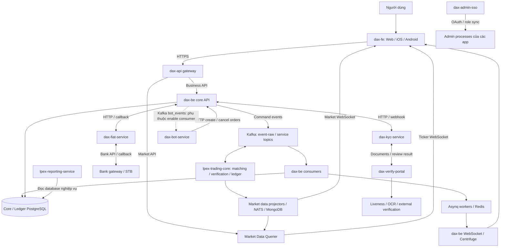
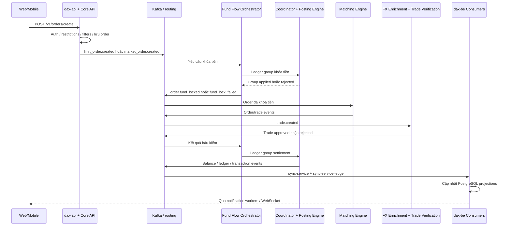
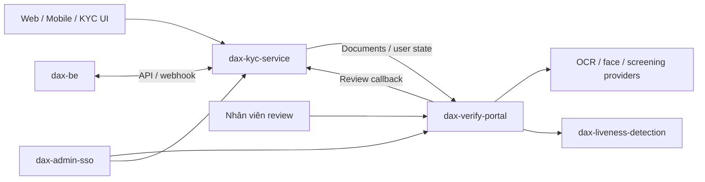

# Kiến trúc LPEX / DAX: overview và detail

Ngày khảo sát: **30/10/2026**. Ngôn ngữ: tiếng Việt.

Bản đào sâu hai repo trung tâm: [dax-be ↔ lpex-trading-core](./dax-be-trading-core-detail.md).

## 1. Phạm vi và cách đọc kết quả

Đã dùng **GitHub CLI**, gồm `gh repo list remitano --limit 1000` và `gh api repos/remitano/{repo}/tarball/{branch}`, để tải và khảo sát snapshot nhánh mặc định của **19 repo có tên chứa `lpex` hoặc `dax`**. Danh sách branch và commit cụ thể nằm ở [lpex-dax-sources.json](./lpex-dax-sources.json). Các link nguồn bên dưới ghim theo commit đã đọc, tránh thay đổi kết luận khi branch tiếp tục cập nhật.

Đây là kiến trúc rút ra từ **source code, entrypoint, routing, dependency và cấu hình triển khai trong repo**. Chưa đọc trạng thái cluster, release đang chạy, secret hay cấu hình runtime thực tế. Vì vậy, “có implementation”, “được khai báo triển khai” và “đang chạy production” là ba mức bằng chứng khác nhau. Tài liệu này không đồng nhất chúng.

Tên LPEX và DAX xuất hiện xen kẽ trong package, domain và tài liệu. Code chứng minh các repo kết nối thành một hệ thống giao dịch; chưa đủ bằng chứng để xác định chính xác quan hệ thương hiệu hoặc pháp nhân giữa các tên này.

## 2. Kết luận kiến trúc tổng thể

Hệ thống có ba phần chính:

1. **Ứng dụng giao dịch:** `dax-fe` cung cấp web/mobile; `dax-be` xử lý tài khoản, xác thực, đặt lệnh, nạp/rút, onboarding, bot lifecycle và quản trị.
2. **Trading engine và ledger:** `lpex-trading-core` giữ order book, khớp lệnh, kiểm tra trade, điều phối dòng tiền và áp dụng bút toán. Backend gửi event yêu cầu rồi nhận event kết quả để cập nhật database phục vụ API.
3. **Dịch vụ chuyên biệt:** fiat/banking, KYC/verification, admin SSO, bot strategy, reporting và quản lý thanh khoản ngoài hệ thống.

Toàn hệ thống kết hợp **HTTP request/callback**, **Kafka event processing**, **NATS market data** và **WebSocket realtime**. Trong backend, business code dùng chung giữa nhiều executable; trong trading core, mỗi engine là một Go module/service riêng.



Sơ đồ mô tả kết nối logic. `dax-be consumers` và worker là các process riêng trong cùng repo. Đường bot được vẽ nét đứt vì cấu hình Convox ở snapshot đang tắt consumer.

Nguồn: [Các process của backend](https://github.com/remitano/dax-be/blob/778975ac8466a3381d08c94f3296c81997b1b0c5/convox.js), [Gateway routing](https://github.com/remitano/dax-be/blob/778975ac8466a3381d08c94f3296c81997b1b0c5/pkg/gateway/router.go), [Các module trading core](https://github.com/remitano/lpex-trading-core/blob/138dfcd1cfaae845ef0f2a77a934c58011129b45/go_services/go.work), [Cấu hình bot consumer](https://github.com/remitano/dax-bot-service/blob/99acdecbdbe1ea01c73d9c6fdf1b21ee3c17a4b2/convox.js).

## 3. Danh mục toàn bộ 19 repo

| Repo | Loại | Vai trò thực tế trong source |
|---|---|---|
| `dax-fe` | App monorepo | Web React và mobile React Native dùng chung UI, models, Redux và network |
| `dax-be` | Backend nhiều executable | Gateway, core API, callback, admin, WebSocket, consumers, workers |
| `lpex-trading-core` | Service monorepo | Matching, conditional orders, market data, verification và ledger |
| `dax-fiat-service` | Service | Nạp/rút fiat, kết nối ngân hàng, routing payment và callback |
| `dax-kyc-service` | Service Rails | Tiếp nhận hồ sơ KYC, document, onboarding và webhook |
| `dax-verify-portal` | App Rails | Xử lý hồ sơ xác minh, OCR/face checks, auto/manual review |
| `dax-admin-sso` | App Rails | Danh tính nhân viên, OAuth, roles, permissions và đồng bộ quyền |
| `lpex-reporting-service` | Service Go | Báo cáo, reconciliation, đọc dữ liệu từ nhiều database |
| `dax-bot-service` | Service Go | Runtime chiến lược DCA/GRID; gọi Core để giao dịch |
| `dax-external-liquidity-balance-manager` | Service Go | Theo dõi và rebalance số dư hệ thống với liquidity providers |
| `dax-be-sim` | Backend demo | Biến thể backend có cấp vốn mô phỏng và hành vi demo |
| `lpex-bankgw-simulation` | App mô phỏng | Giả lập bank gateway/STB và các callback thanh toán |
| `dax-liveness-detection` | Web + serverless backend | Challenge phát hiện khuôn mặt sống; Vue/JS và AWS SAM/Python |
| `dax-admin` | Thư viện Go | Fork GoAdmin; được app import/replace, không phải riêng app admin giao dịch |
| `dax-portal-connectors` | Ruby gem | HTTP connectors dùng chung giữa các portal |
| `dax-signer` | Go library | Ký payload HTTP bằng HMAC-SHA512 |
| `dax-ruby-signer` | Ruby gem | Ký request REST ở phía Ruby |
| `dax-kyc-sdk` | SDK frontend | UI và kết nối API/socket cho quy trình KYC |
| `gitops-lpex` | Repo ở nhánh đã đọc | Chỉ thấy README; chưa có manifest để dựng topology triển khai |

## 4. `dax-fe`: web/mobile hoạt động như thế nào

`dax-fe` là Nx monorepo. `packages/web-app` là ứng dụng web, `packages/dax-mobile` là ứng dụng React Native. Các phần dùng chung gồm `ui`, `components`, `models`, `redux`, `network`, `constants`, `utils`, `locale`, `theme` và `kyc-sdk`.

Luồng điển hình: màn hình nhận thao tác → action/state và logic bất đồng bộ → `packages/network/src/api` → API HTTP → cập nhật Redux/UI. Ví dụ API đặt lệnh gọi `POST /v1/orders/create`; API tạo và dừng bot cũng gọi backend qua `/v1/bots`, không gọi trực tiếp runtime bot-service.

Realtime có client **Centrifuge** trong `packages/network/src/socket/dax` để nhận cập nhật tài khoản/lệnh và các kênh được app đăng ký. Market data có cấu hình endpoint riêng. Ngoài ra còn có MQTT over WebSocket: code chỉ bật khi `MQTT_BROKER_URL` được cấu hình. Chưa có bằng chứng trong 19 repo để chỉ ra service nào chuyển Kafka thành MQTT cho môi trường thực tế.

KYC có hai điểm tích hợp cần phân biệt: SDK KYC nội bộ trong monorepo và repo `dax-kyc-sdk` riêng. Không nên mặc định app hiện tại dùng package từ repo riêng. Riêng flow `verify-identity-api.ts` chọn endpoint `SCEX_GATEWAY_SERVICE_API` cho initiate/status/nonce/liveness; điều đó cho thấy app còn phụ thuộc một gateway ngoài tập repo khảo sát.

`packages/relay-server` và socket mock server được dùng cho phát triển/E2E; không suy diễn chúng là gateway production.

Nguồn: [Cấu trúc FE](https://github.com/remitano/dax-fe/blob/739711e97809f7574ca10490f8ecf34829a42c01/README.md), [Order API](https://github.com/remitano/dax-fe/blob/739711e97809f7574ca10490f8ecf34829a42c01/packages/network/src/api/order-api.ts), [Bot API](https://github.com/remitano/dax-fe/blob/739711e97809f7574ca10490f8ecf34829a42c01/packages/network/src/api/bot-api.ts), [Centrifuge client](https://github.com/remitano/dax-fe/blob/739711e97809f7574ca10490f8ecf34829a42c01/packages/network/src/socket/dax/websocket.wrapper.ts), [MQTT enable flag](https://github.com/remitano/dax-fe/blob/739711e97809f7574ca10490f8ecf34829a42c01/packages/network/src/mqtt/mqtt-singleton.ts), [Identity gateway](https://github.com/remitano/dax-fe/blob/739711e97809f7574ca10490f8ecf34829a42c01/packages/network/src/api/verify-identity-api.ts).

## 5. `dax-be`: một repo, nhiều process

### 5.1 Các executable và trách nhiệm

| Process | Chức năng | Giao tiếp chính |
|---|---|---|
| `dax-api` | Gateway công khai: xác thực, rate limit và reverse proxy | FE → Core hoặc Market Data Querier |
| `backend` / root `main.go` | Business API nội bộ | PostgreSQL, Redis, Kafka, outbound HTTP |
| `websocket` / `ws-server` | Endpoint realtime Centrifuge | Client WebSocket, Redis broker |
| `callback_server` | Nhận callback đối tác | KYC, coin portal, fiat, SSO, e-contract, market data |
| `admin` | Back office giao dịch | GoAdmin, services/repositories, SSO |
| `consumer` | Chiếu event nghiệp vụ vào DB | `sync-service` → Core PostgreSQL |
| `consumer_ledger` | Chiếu bút toán/accounting | `sync-service-ledger` → Ledger PostgreSQL |
| `consumer_rates` | Cập nhật giá/tỷ giá | `sync-service-exchange-rates` → dữ liệu/cache/backend |
| `consumer_dlq` | Tiếp nhận event lỗi từ DLQ đã cấu hình | Kafka → dữ liệu phục vụ xử lý lỗi |
| `queue-scheduler` | Enqueue công việc định kỳ | Redis/Asynq; cấu hình một instance |
| `queue-heavy` | Tác vụ core, AML, custody fee, ưu tiên cao | Asynq → business services |
| `queue-admin` | Retry persistence, export, report, version | Asynq → DB/object storage |
| `queue-db-finalizer` | Hoàn tất dữ liệu ghi trễ theo watermark | Cấu hình một instance |
| `queue-funding` | Nạp coin/fiat, funding và trading tasks | Asynq → business services |
| `queue-notification` | Notification và push số dư/lệnh/trade | Asynq → WebSocket/notification |
| `sms-sender` | Tách việc gửi SMS thành service | HTTP → provider |
| `mock-server` | Stub external providers | Hỗ trợ môi trường phát triển/test |

Danh sách trên được đối chiếu entrypoint và `convox.js`. Một số consumer có replica bằng 0 ở các nhánh điều kiện staging của file này. Đây là cấu hình trong repo, không phải kết quả kiểm kê pod đang chạy.

### 5.2 Request vào backend

1. FE gọi `dax-api`.
2. Gateway loại các trusted header `DX-*` do client gửi, xác thực JWT/API key và rate limit.
3. Gateway chèn identity/context đã xác thực, reverse proxy tới Core.
4. Core nạp trusted context, áp quyền của từng route, gọi controller → service → repository.
5. Với hành vi ảnh hưởng engine, service lưu yêu cầu nghiệp vụ và phát Kafka event. Kết quả xử lý cuối cùng được đồng bộ lại bằng consumer.

Market-data path được gateway phân tuyến riêng tới querier và không dùng cùng authentication chain với business API. Trong `convox.js`, `CORE_SERVICE_URL` trỏ tới `http://backend`; `MARKET_DATA_URL` trỏ tới market-data-querier. Vì vậy “Core” ở gateway là **backend business API**, không đồng nghĩa Matching Engine.

### 5.3 Layer bên trong

```text
HTTP router → Controller → Service → Repository → GORM/PostgreSQL
                              ├→ HTTP clients: fiat/KYC/coin/contract…
                              ├→ EventEmitter → Kafka
                              └→ Asynq enqueue → worker → Service
Kafka consumer → Event handler → DB committer → PostgreSQL projections
```

`services/` giữ business rules. `clients/` chứa adapter tới hệ thống ngoài. `serializers/` tạo response. `toolkits/` gom Redis, queue, S3 và helper dùng chung. `base_consumer/` điều phối partition, xử lý event và batch database writes.

### 5.4 Data ownership

- **Core PostgreSQL:** user/session, yêu cầu order, trạng thái nghiệp vụ, coin/fiat workflow và các projection từ engine.
- **Ledger PostgreSQL:** account, ledger entry và entry group được consumer đồng bộ để truy vấn/accounting.
- **Versions database:** lịch sử thay đổi phục vụ audit; có thể fallback về primary khi chưa bật cấu hình riêng.
- **Redis:** cache, Asynq queue, WebSocket broker và các trạng thái hỗ trợ.
- **S3/local snapshot/Redis checkpoint:** phục hồi consumer và idempotency theo từng cơ chế trong code.

Backend có tạo order record ban đầu, nên không thể gọi toàn bộ DB này là read-only. Tuy nhiên, số dư cuối cùng và kết quả matching được quyết định trong engine, rồi chiếu về backend. Đây là sự phân tách command/projection theo hướng CQRS, dù hệ thống không tách mọi bảng thành hai database độc lập.

Nguồn: [Process definitions](https://github.com/remitano/dax-be/blob/778975ac8466a3381d08c94f3296c81997b1b0c5/convox.js), [Gateway](https://github.com/remitano/dax-be/blob/778975ac8466a3381d08c94f3296c81997b1b0c5/pkg/gateway/router.go), [Database setup](https://github.com/remitano/dax-be/blob/778975ac8466a3381d08c94f3296c81997b1b0c5/database/database.go), [Order creation/event emission](https://github.com/remitano/dax-be/blob/778975ac8466a3381d08c94f3296c81997b1b0c5/services/order/create.go), [Event-to-projection mapping](https://github.com/remitano/dax-be/blob/778975ac8466a3381d08c94f3296c81997b1b0c5/base_consumer/event_handler/manager.go), [Architecture tham chiếu](https://github.com/remitano/dax-be/blob/778975ac8466a3381d08c94f3296c81997b1b0c5/docs/repo-wiki/architecture.md).

## 6. `lpex-trading-core`: hoạt động của từng service

### 6.1 Event backbone

Backend phát command event vào `event-raw`. `fan_out_worker` đọc và route event tới topic riêng của engine theo bảng event routing. Bảng này quyết định cả đích và partition key.

Engine có thêm cơ chế **direct publish**: khi bật, event đủ điều kiện đi thẳng topic đích theo bảng routing; không nhất thiết quay lại `event-raw`. Broadcast và một số event điều khiển vẫn cần fanout. Vì vậy không thể dùng giả định “mọi event đều nằm trong event-raw” cho trace hay audit ở mọi cấu hình.

Event engine dùng Protobuf/Schema Registry. Mỗi stateful consumer xử lý các partition được giao, giữ state và snapshot để restart/replay. Thứ tự được bảo đảm trong partition; không có một thứ tự toàn cục giữa tất cả engine.

### 6.2 Matching và post-matching

| Service | Input / công việc | Output / bên nhận |
|---|---|---|
| `matching_engine` | Nhận limit/market order đã khóa tiền; giữ limit order book trong RAM; price-time priority, cancel, partial fill, STP | Trade/order events → market data, verification pipeline, fund flow và backend projection |
| Matching Engine Hot-1 | Cùng binary matching engine, topic và snapshot namespace riêng; route symbol nóng theo mapping khi bật | Cùng loại output như pool mặc định |
| `conditional_order_manager` | Giữ stop/conditional/trailing-stop order đã khóa tiền; theo dõi last price | Khi trigger, đưa lệnh tương ứng sang matching path; hỗ trợ cancel pending order |
| `exchange_rate_enrichment_service` | Bổ sung tỷ giá liên quan cho event cần xử lý tiếp | Enriched event → verification/downstream |
| `trade_verification_service` | Kiểm tra matched price, amount, fee/tax và guardrails | `trade.auto_approved` / `trade.auto_rejected` → Fund Flow Orchestrator; có đường manual review bên backend |

Một symbol cần thuộc đúng matching pool tại một thời điểm. Hot-1 là cơ chế cô lập tải theo symbol/topic, không phải hai engine cùng sửa một order book.

### 6.3 Balance và ledger

| Service | Trách nhiệm |
|---|---|
| `fund_flow_orchestrator` (FFO) | Chuyển nghiệp vụ như khóa tiền, trade settlement, deposit/withdrawal thành nhóm bút toán kép; theo dõi kết quả và phát event hoàn tất/thất bại nghiệp vụ |
| `ledger_entry_coordinator` (LEC) | Điều phối nhiều entry của một group: chờ reserve/ready, yêu cầu apply hoặc cancel; chỉ kết luận group khi các entry đạt điều kiện |
| `ledger_posting_engine` (LPE) | Giữ state tài khoản; kiểm tra/reserve/apply/cancel entry; là nơi quyết định thay đổi số dư ledger |

Luồng thành công: `ledger_entry_group.initiated` → `ledger_entry.initiated` → tất cả `ready` → `apply_requested` → tất cả `applied` → `ledger_entry_group.applied` → FFO phát kết quả nghiệp vụ.

Nếu một entry bị reject ở pha reserve, coordinator hủy reservation đã thành công và kết luận group thất bại. Đây là coordination qua event/state machine; không phải một SQL transaction bao trùm mọi service. Ý nghĩa all-or-nothing phụ thuộc invariant, replay và cơ chế phục hồi của protocol.

Khóa tiền hoàn tất **trước** khi order được đưa vào matching hoặc conditional-order manager. Trade đã được match vẫn cần hậu kiểm và settlement; “match xảy ra” và “tiền đã tất toán” là hai mốc khác nhau.

### 6.4 Market data hiện tại

Tài liệu cũ gọi chung `market_data_service`, nhưng code hiện tại đã tách:

| Service | Cách hoạt động |
|---|---|
| `external_market_listener` | Kết nối nguồn ngoài như Binance/OKX/KuCoin và nguồn FX bằng REST/WS; chuẩn hóa ticker rồi phát NATS |
| `market_data_internal_projector` | Consume event matching nội bộ; dựng order-book ladder, matched trades và K-lines; ghi MongoDB, phát NATS/WS |
| `market_data_overall_projector` | Kết hợp giá nội bộ/ngoài và cấu hình price oracle; tính giá/tỷ giá tổng hợp; phát NATS và Kafka; có leader gate |
| `market_data_querier` | Dựng read model từ NATS; đọc lịch sử MongoDB; phục vụ HTTP `/api/v1/markets/*` và ticker24h WS; không ghi matched trades/K-lines |
| `market_data_exporter` | Đọc Kafka inbox export của các nguồn market data và chuyển sang Kafka in-house `market_data_internal_messages`; phụ thuộc enable/config |

Exporter là một nhánh phân phối dữ liệu. Source publish gốc không chờ inbox export; nhánh source→inbox có thể bỏ record khi lỗi/đầy buffer. Từ inbox→Kafka in-house là at-least-once và commit sau ack. Không nên gán bảo đảm giao nhận của ledger cho nhánh market-data export này.

### 6.5 Supporting/compliance/tools

| Thành phần | Vai trò và giới hạn |
|---|---|
| `fan_out_worker` | Route event-raw tới service topics, validation và các nhánh DLQ |
| `timer_service` | Phát heartbeat dùng cho tác vụ theo thời gian, timeout, snapshot |
| `recent_events_storer` | Lưu event gần đây để tra cứu/debug; không mặc định bao phủ event bypass event-raw |
| `supporting_service` | Hỗ trợ vận hành, gồm decode snapshot và tích hợp callback tới backend |
| `transaction_monitoring` | Có implementation AML/off-chain risk; tài liệu architecture 1.0.2 ghi hiện không chạy, chưa xác minh cluster |
| `kline_backfill` | Công cụ backfill candles, không phải matching hot path |
| `debug_by_real_events` | Công cụ chẩn đoán/replay theo event |
| `sample`, `demo_tiered_storage`, `integration_tests` | Mã mẫu, thử nghiệm hoặc kiểm thử; không mặc định là app production |

Nguồn: [Event routing](https://github.com/remitano/lpex-trading-core/blob/138dfcd1cfaae845ef0f2a77a934c58011129b45/go_services/pkg/common/event_routing/matrix.go), [Direct publisher](https://github.com/remitano/lpex-trading-core/blob/138dfcd1cfaae845ef0f2a77a934c58011129b45/go_services/pkg/common/event_routing/direct_publisher.go), [Kiến trúc core cập nhật](https://github.com/remitano/lpex-trading-core/blob/138dfcd1cfaae845ef0f2a77a934c58011129b45/docs/trading-core-architecture-1.0.2.md), [Market data split](https://github.com/remitano/lpex-trading-core/blob/138dfcd1cfaae845ef0f2a77a934c58011129b45/docs/market_data_service/README.md), [Querier ownership](https://github.com/remitano/lpex-trading-core/blob/138dfcd1cfaae845ef0f2a77a934c58011129b45/docs/market_data_querier/README.md), [Market data export](https://github.com/remitano/lpex-trading-core/blob/138dfcd1cfaae845ef0f2a77a934c58011129b45/docs/market_data_service/architecture/in-house-kafka-export.md).

## 7. Luồng đặt lệnh từ đầu đến cuối



Sơ đồ giản lược event trung gian và direct-publish. HTTP response đặt lệnh không đồng nghĩa trade đã khớp và settle. UI theo dõi các trạng thái tiếp theo bằng query/realtime. Với order chưa match hoặc chỉ partial fill, phần tiền còn khóa phải được xử lý theo vòng đời cancel/expiry/execute tương ứng. Với conditional order, nhánh sau khóa tiền đi qua Conditional Order Manager trước Matching Engine.

Nguồn: [Backend tạo order/event](https://github.com/remitano/dax-be/blob/778975ac8466a3381d08c94f3296c81997b1b0c5/services/order/create.go), [Routing thực tế](https://github.com/remitano/lpex-trading-core/blob/138dfcd1cfaae845ef0f2a77a934c58011129b45/go_services/pkg/common/event_routing/matrix.go), [Fund lock / matching / settlement](https://github.com/remitano/lpex-trading-core/blob/138dfcd1cfaae845ef0f2a77a934c58011129b45/docs/trading-core-architecture-1.0.2.md).

## 8. Fiat: `dax-fiat-service` và bank simulator

### 8.1 Vai trò fiat service

Service Go/Gin/GORM có PostgreSQL, Redis/Asynq và admin riêng. Nó quản lý fiat accounts, deposits, withdrawals, bank catalog, payment/statement và callback. Backend vẫn sở hữu trạng thái giao dịch phía người dùng; fiat service sở hữu tích hợp payment rail và dữ liệu nghiệp vụ banking của service.

**Nạp fiat:** ngân hàng/bank gateway báo tiền về → fiat service nhận/đồng bộ deposit → xử lý beneficiary/name mismatch, confirm/review/reject/refund → postback tới backend → backend áp workflow verification/approval → engine thực thi ledger → consumer cập nhật số dư và trạng thái → UI nhận kết quả.

Callback ghi nhận deposit không tự đồng nghĩa balance được credit. Backend có guard trạng thái, idempotency theo portal reference và các bước funding riêng.

**Rút fiat:** người dùng tạo yêu cầu trên backend → xác nhận/kiểm tra và khóa tiền theo workflow → backend submit withdrawal tới fiat service → fiat service route payment → nhận kết quả provider và postback → backend điều phối hoàn tất/hoàn tiền theo trạng thái bằng engine events.

Routing trong code có legacy Bank Gateway và new flow chọn **STB hoặc Bank Gateway** theo cấu hình. Vì vậy không thể khẳng định mọi payment đều đi qua cùng một gateway. API banking là HTTP với callback/polling, không phải chỉ Kafka.

### 8.2 Bank simulator

`lpex-bankgw-simulation` có endpoint giả lập bank payment, callback, refcode và STB online payment. Mục đích thể hiện trong code là cung cấp đối tác thanh toán mô phỏng. Nó không chứng minh ngân hàng thật được triển khai trong repo, cũng không phải nguồn ledger người dùng.

Nguồn: [Bank/STB/Primary portal clients](https://github.com/remitano/dax-fiat-service/blob/55836c614679ac6f8b16d7a6c05d5914b1121ee6/clients/clients.go), [Payment routing](https://github.com/remitano/dax-fiat-service/blob/55836c614679ac6f8b16d7a6c05d5914b1121ee6/services/withdrawal/handle_routing.go), [Deposit postback](https://github.com/remitano/dax-fiat-service/blob/55836c614679ac6f8b16d7a6c05d5914b1121ee6/services/deposit/postback_to_primary_portal.go), [Backend nhận deposit](https://github.com/remitano/dax-be/blob/778975ac8466a3381d08c94f3296c81997b1b0c5/services/fiat_deposit/fiat_service_postback_handler.go), [Backend submit withdrawal](https://github.com/remitano/dax-be/blob/778975ac8466a3381d08c94f3296c81997b1b0c5/services/fiat_withdrawal/fiat_service_submit_handler.go), [Simulator controllers](https://github.com/remitano/lpex-bankgw-simulation/blob/2d7f1aa8c73f5f26a9b2e9a185cbf0330990c6db/controllers/controllers.go).

## 9. KYC và verification: các app tương tác thế nào



Sơ đồ là nhánh KYC/portal đã thấy trong code. Flow identity mới của FE có gateway SCEX riêng, nên không phải mọi thao tác xác minh đều đi nguyên tuyến này.

- **`dax-kyc-service`:** Rails app lưu users/documents/video/liveness/risk/onboarding. API và UI KYC nhận hồ sơ. Resque chạy tác vụ eKYC/sync; Sidekiq xử lý upload ở queue carrierwave; Clockwork chạy công việc định kỳ. Khi dữ liệu sẵn sàng, gửi hồ sơ tới verify portal qua connector. Khi nhận review callback, cập nhật document/user state; thay đổi liên quan tạo webhook cho client như backend.
- **`dax-verify-portal`:** Rails app phục vụ review operations. Có pipeline precheck → collect/document processing → postcheck/store, OCR/face/NFC checks, auto approval và manual review. Kết quả trả về KYC service; không trực tiếp sửa bảng users trong backend.
- **`dax-kyc-sdk`:** SDK React/React Native với UI capture/upload và API/socket configuration. Đây là package tích hợp, không phải server xử lý KYC. FE hiện còn có `packages/kyc-sdk` riêng.
- **`dax-liveness-detection`:** có web client Vue/JS và backend AWS SAM/Python. User thực hiện challenge đưa mũi vào vùng chỉ định và xoay mặt; ứng dụng kiểm tra một khuôn mặt và việc hoàn thành challenge. Code/deployment template cho thấy hệ thống phụ trợ độc lập, không phải matching service.

Nguồn: [KYC processes](https://github.com/remitano/dax-kyc-service/blob/fa474a8684b9ef152d8354081075b73ec3b7e0f5/Procfile), [Sync sang verify portal](https://github.com/remitano/dax-kyc-service/blob/fa474a8684b9ef152d8354081075b73ec3b7e0f5/app/models/concerns/has_rverify_portal.rb), [Review callback](https://github.com/remitano/dax-kyc-service/blob/fa474a8684b9ef152d8354081075b73ec3b7e0f5/app/models/concerns/has_rverify_portal_callback.rb), [Client webhooks](https://github.com/remitano/dax-kyc-service/blob/fa474a8684b9ef152d8354081075b73ec3b7e0f5/app/models/concerns/has_web_hooks.rb), [Review pipeline](https://github.com/remitano/dax-verify-portal/blob/92d363cf2a53dbbc50e190e0e78e92a4445f90a3/app/ekyc/review_process/base.rb), [SDK integration](https://github.com/remitano/dax-kyc-sdk/blob/f78b897631a30070fb7315a6c2e4fe559306b569/README.md), [Liveness architecture](https://github.com/remitano/dax-liveness-detection/blob/249bd8422392495a2a4806324b48c10ab743165a/README.md).

## 10. Quản trị: SSO khác với admin app và admin library

**`dax-admin-sso`** là app Rails quản lý admin users, roles, permissions, divisions, login/activity và các đối tượng OAuth/Doorkeeper. Staff đăng nhập qua SSO; các app nhận danh tính và quyền, có callback để cập nhật thông tin quyền ở local app. Các process web, Resque và Clockwork thực thi login, sync và công việc định kỳ.

**Ứng dụng admin giao dịch** nằm ở **`dax-be/admin`**, được build/run thành process riêng. Fiat, bot và reporting cũng có admin riêng. Admin chia sẻ service/repository của app tương ứng, nên thao tác quản trị có thể phát sinh business workflow và Kafka event.

**`dax-admin`** là fork của `github.com/GoAdminGroup/go-admin`. `go.mod` các app dùng `replace` để trỏ framework tới repo này với version khác nhau. Thay đổi framework ở repo `dax-admin` chỉ có hiệu lực sau khi app nâng version/build lại.

**`dax-portal-connectors`** là Ruby gem chứa adapter giao tiếp portal. **`dax-signer`** và **`dax-ruby-signer`** là thư viện ký request REST, không phải service custody ký blockchain transaction. Go signer chuẩn hóa payload rồi dùng HMAC-SHA512; xác thực và replay protection cụ thể còn phụ thuộc client/middleware từng app.

Nguồn: [Admin identity](https://github.com/remitano/dax-admin-sso/blob/51ef15172bd2abe7c39983024b933d23d0b4f19b/app/models/admin_user.rb), [SSO/OAuth routes](https://github.com/remitano/dax-admin-sso/blob/51ef15172bd2abe7c39983024b933d23d0b4f19b/config/routes.rb), [Admin executable](https://github.com/remitano/dax-be/blob/778975ac8466a3381d08c94f3296c81997b1b0c5/admin/main.go), [Framework replace](https://github.com/remitano/dax-be/blob/778975ac8466a3381d08c94f3296c81997b1b0c5/go.mod), [Module GoAdmin](https://github.com/remitano/dax-admin/blob/dea082c71bc7e6e21d2d535e68e2ba5ee37817b6/go.mod), [Ruby connectors](https://github.com/remitano/dax-portal-connectors/blob/6ced370e826cd47bbba331638721d3e5186a5814/README.md), [HMAC implementation](https://github.com/remitano/dax-signer/blob/cf0cf850df1ada68c0c3c0ed7f273aa914b3fd2c/signer.go), [Ruby request signer](https://github.com/remitano/dax-ruby-signer/blob/34795cb1e7c4ab206aecdc8543cc5f676122dd08/README.md).

## 11. Trading bot: Core sở hữu tiền, bot-service sở hữu chiến lược

FE tạo/xem/dừng bot qua `dax-be`. Core giữ cấu hình bot, owner, bot-user assignment, funding, lệnh/trade và lifecycle. `dax-bot-service` giữ runtime chiến lược, order projection và tính toán bước giao dịch tiếp theo.

Hai chiều tích hợp:

- **Core → bot-service:** Kafka JSON `bot_events`, gồm lifecycle và order execution/cancel; ordering theo bot-user và contract sequence/idempotency của consumer.
- **Bot-service → Core:** HTTP client để tạo/hủy/query order, kể cả batch và correlation bằng client order ID. Bot không tự sửa số dư hay order table của Core.

DCA đã có code cho base order, safety ladder, xử lý buy execution, thay take-profit và tiếp tục cycle. GRID có runtime/levels/order pairs và logic xử lý chiến lược riêng. Consumer có snapshot/checkpoint và DB committer để dựng runtime projections.

**Trạng thái cần giữ rõ:** tại snapshot, `convox.js` đặt consumer `count: 0`, `KAFKA_CONSUMER_ENABLED=false`. Public router bot service chỉ đăng ký `/ping` và Swagger; không expose API `/v1/bots` cho FE ở đó. Vì vậy có implementation DCA/GRID không đủ để kết luận bot đang tự động chạy production. Cần kiểm tra release/override và producer contract thực tế.

Nguồn: [FE gọi Core](https://github.com/remitano/dax-fe/blob/739711e97809f7574ca10490f8ecf34829a42c01/packages/network/src/api/bot-api.ts), [DCA contract](https://github.com/remitano/dax-bot-service/blob/99acdecbdbe1ea01c73d9c6fdf1b21ee3c17a4b2/services/bot_dca/service.go), [GRID contract](https://github.com/remitano/dax-bot-service/blob/99acdecbdbe1ea01c73d9c6fdf1b21ee3c17a4b2/services/bot_grid/service.go), [Core HTTP client](https://github.com/remitano/dax-bot-service/blob/99acdecbdbe1ea01c73d9c6fdf1b21ee3c17a4b2/clients/dax_core_client/base.go), [Bot public routes](https://github.com/remitano/dax-bot-service/blob/99acdecbdbe1ea01c73d9c6fdf1b21ee3c17a4b2/routers/router.go), [Consumer disabled mặc định](https://github.com/remitano/dax-bot-service/blob/99acdecbdbe1ea01c73d9c6fdf1b21ee3c17a4b2/convox.js).

## 12. Reporting và thanh khoản ngoài

### 12.1 `lpex-reporting-service`

Go/Gin/GORM, admin và Asynq worker/scheduler. Service có database reporting riêng và kết nối tới **CoreDB, LedgerDB, FiatServiceDB**, cộng **CoinWalletDB khi được bật**. Nó dựng báo cáo và reconciliation cho deposit/withdrawal, trade, trading fee/tax, ledger entries, user/system transaction logs và balance snapshot integrity; có hourly metrics và processing-time/SLA jobs.

Điểm kiến trúc quan trọng: đây là **đọc chéo database nghiệp vụ**, không chỉ gọi business API. Reconciliation phụ thuộc schema và độ mới của dữ liệu nguồn. Kết quả báo cáo có thể chậm hơn giao dịch vì projection, batch jobs và replica; khi điều tra lệch số liệu cần so cùng mốc thời gian/watermark.

Ngoài các database, service còn có fiat callback client. Không có bằng chứng để coi reporting là nơi quyết định số dư giao dịch.

Nguồn: [Cross-database connections](https://github.com/remitano/lpex-reporting-service/blob/1e3706a7852ce8bdf3104dadb5a1ea5902021f50/database/database.go), [Scheduled processing](https://github.com/remitano/lpex-reporting-service/blob/1e3706a7852ce8bdf3104dadb5a1ea5902021f50/queue/processor.go), [Reconciliation service](https://github.com/remitano/lpex-reporting-service/blob/1e3706a7852ce8bdf3104dadb5a1ea5902021f50/services/reconciliation/service.go), [Fiat callback client](https://github.com/remitano/lpex-reporting-service/blob/1e3706a7852ce8bdf3104dadb5a1ea5902021f50/clients/clients.go).

### 12.2 `dax-external-liquidity-balance-manager`

Service Go có database, admin và scheduled jobs. Nó refresh số dư phía provider và hệ thống, tính allocation thiếu/thừa, điều phối rebalance/transfer, theo dõi pending/confirming transfers và đồng bộ deposit/withdrawal hai phía.

Các adapter `provider_account_client` và `system_account_client` kết nối hệ thống/provider qua HTTP; producer có support engine-event entities. Đây là **quản lý inventory/thanh khoản bên ngoài**, không thay Matching Engine hay user ledger. Chưa đủ bằng chứng từ các repo đã đọc để khẳng định provider nào đang cấu hình, service có đang được bật hay rule rebalance nào đang dùng.

Nguồn: [Balance management responsibilities](https://github.com/remitano/dax-external-liquidity-balance-manager/blob/a7e381e155c4d321087b6c52ae678c8dece73aed/services/balance_manager/service.go), [Provider adapter](https://github.com/remitano/dax-external-liquidity-balance-manager/blob/a7e381e155c4d321087b6c52ae678c8dece73aed/clients/provider_account_client/base.go), [System adapter](https://github.com/remitano/dax-external-liquidity-balance-manager/blob/a7e381e155c4d321087b6c52ae678c8dece73aed/clients/system_account_client/base.go).

## 13. Demo/SIM và quan hệ với PRO

`dax-be-sim` có cùng nền tảng Go/Gin/GORM với backend chính; nhánh mặc định khi đọc là **`vault_sim_2`**. Có `demo_balance_seed` tạo deposit mô phỏng, phát approval event và chuyển vốn từ funding sang spot sau khi số dư xuất hiện. Demo feature-lock hạn chế nạp/rút thật nhưng cho phép trading theo rule trong code.

Trong `dax-be` có bridge SIM/PRO và tài liệu migration. Luồng được mô tả là SIM xác thực người dùng hiện tại → gọi internal endpoint PRO đã ký → PRO tạo hoặc tìm tài khoản liên kết → cấp token → SIM lưu peer mapping. Migration chuyển dữ liệu tài khoản/liên kết; tài liệu không chuyển KYC, contract và onboarding verification state. Không có cơ sở để nói migration này chuyển số dư demo thành tiền thật.

SIM và PRO cần được xem là hai backend/môi trường có peer bridge. Repo đơn lẻ không đủ xác định liệu chúng dùng chung Kafka/DB hay namespace nào trong deployment thực tế.

Nguồn: [Demo funding](https://github.com/remitano/dax-be-sim/blob/24b38c19b159fd4921049a0cb212506a480e73fa/services/demo_balance_seed/service.go), [Demo restrictions](https://github.com/remitano/dax-be-sim/blob/24b38c19b159fd4921049a0cb212506a480e73fa/services/feature_locked/service.go), [SIM → PRO bridge](https://github.com/remitano/dax-be/blob/778975ac8466a3381d08c94f3296c81997b1b0c5/docs/api/sim-to-pro-migration.md).

## 14. Ma trận giao tiếp và nguồn dữ liệu

| Từ | Đến | Cơ chế | Ý nghĩa |
|---|---|---|---|
| FE | dax-api → Core | HTTP + JWT/API key | Thao tác và query nghiệp vụ |
| Gateway | Market Data Querier | Reverse proxy HTTP | Query market data |
| Backend | Trading core | Kafka Protobuf, event-raw/routing | Command/event nghiệp vụ |
| Core engines | Core engines | Kafka; direct publish khi bật | Matching, fund lock, settlement |
| Core engines | Backend consumers | Các topic sync-service* | Đồng bộ projection/accounting/rates |
| Backend workers | FE | Centrifuge WS + Redis broker | Account/order/notification realtime |
| External listener/projectors | Market read models | NATS | Ticker, ladders, giá/tỷ giá |
| Internal projector | MongoDB | Database writes | Matched trades và candles |
| Querier | MongoDB | Database reads | Lịch sử market data |
| Market sources | Exporter → Kafka in-house | Kafka inbox/export | Phân phối market data ra hệ thống khác |
| Backend | Fiat service | Signed HTTP + callback | Nạp/rút fiat |
| Fiat service | Bank gateway/STB | Provider HTTP + callback/poll | Thực thi payment |
| Backend/FE KYC flow | KYC service | API/socket/webhook tùy nhánh | Hồ sơ và trạng thái xác minh |
| KYC service | Verify portal | HTTP connector + callback | Review documents |
| Admin app | Admin SSO | OAuth + quyền/callback | Danh tính và phân quyền staff |
| Core | Bot service | Kafka JSON khi consumer bật | Lifecycle và order updates |
| Bot service | Core | HTTP | Tạo/hủy/query order |
| Reporting | Core/Ledger/Fiat/Coin DB | SQL connections | Report và reconciliation |
| SIM | PRO | Signed internal HTTP | Link/migrate user/session |

## 15. Những điểm đã xác định và còn thiếu bằng chứng

1. **Kiến trúc đã thay đổi so với tài liệu cũ.** Bản trading-core overview tháng 6 còn nói Market Data Service monolith. Code hiện tại có các projector, querier, exporter; nên ưu tiên module/entrypoint và tài liệu split mới.
2. **Không phải repo nào cũng là app.** Admin framework, signers, SDK và connectors là dependency. Runtime admin nằm trong từng business repo.
3. **Không thể khẳng định topology production từ Convox.** Repo có Helm, Convox, scripts và nhiều môi trường; replica/flag có thể được override.
4. **`gitops-lpex/master` chỉ có README** ở commit đã đọc. Không có manifest production để kiểm tra routing, namespace, release image hay replica thực tế. Không kết luận các branch khác cũng trống.
5. **Coin wallet/custody là dependency nhìn từ backend**, qua `clients/coin_portal_client` và callbacks. Trong danh sách repo truy cập được lần này không thấy `dax-coin-wallet`, dù tên này có trong tài liệu integrations. Chưa đọc implementation custody, blockchain watcher, key management hoặc hot/cold wallet.
6. **SCEX identity gateway, affiliate, MQTT bridge và các provider ngoài** chưa nằm đầy đủ trong tập repo đã đọc. Chỉ xác nhận được hợp đồng gọi từ source phía client, không dựng chi tiết phần server chưa có.
7. **Bot consumer đang tắt trong Convox snapshot; AML runtime được tài liệu core ghi là chưa chạy.** Cần runtime inventory để xác nhận trạng thái thực tế, không nên vẽ cả hai như các bước bắt buộc đang hoạt động của mọi giao dịch.
8. **Có eventual consistency.** Engine, PostgreSQL projections, notifications và reporting đi qua các pipeline riêng. API/UI/report có thể quan sát những mốc xử lý khác nhau.
9. **Không giả định exactly-once toàn hệ thống.** Code có idempotency, snapshot, retry, DLQ và failed-event persistence; đó là các cơ chế cụ thể, không tự biến HTTP/Kafka/DB thành một transaction duy nhất.

## 16. Điểm vào source khi cần đào sâu

| Muốn hiểu | Đọc trước |
|---|---|
| Đặt/hủy lệnh | `dax-be/services/order`, sau đó event routing và matching engine |
| Số dư sai hoặc khóa tiền treo | FFO → LEC → LPE, rồi backend consumer/projection |
| Giá/nến/order book sai | Internal/Overall Projector → NATS/MongoDB → Querier |
| Nạp/rút fiat treo | Backend funding workflow → fiat callback → payment routing → provider result |
| KYC chưa lên trạng thái | KYC document processing → verify portal sync/review → KYC webhook → backend callback |
| Bot không đặt lệnh | Consumer enable/replicas → bot_events contract → strategy runtime → Core HTTP response |
| Báo cáo lệch ledger | Source DB config → projection watermark → reconciliation job và cutoff |
| Staff mất quyền | SSO role/permission → callback sync → local admin user/role |

Bản khảo sát tập trung vào kiến trúc và các đường tương tác chính; không chạy unit/integration test hay gọi API giao dịch thật. Source snapshot tải bằng GitHub CLI được giữ tại `/tmp/lpex-dax-review` để tiếp tục tra cứu trong phiên làm việc.
