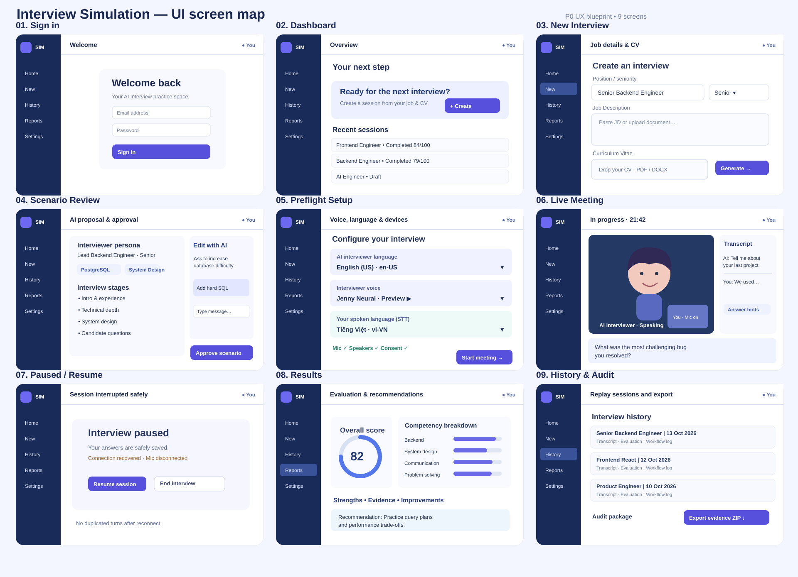

# UI / UX Screen Specification — Interview Simulation

**Status:** UX blueprint for P0 (reviewable, not an implemented application)  
**Approved architecture:** pnpm, Next.js full-stack, SQLite/Drizzle, Azure Speech, pluggable LLM; see [technical architecture](../TECHNICAL_ARCHITECTURE.md) in this same PR.  
**Artifacts:** [Nine-screen storyboard](./mockups-overview.svg) | [Interactive static prototype](./prototype.html) (open in browser locally)

## 1. Navigation and user journey

Sign in → Dashboard → Create interview (JD + CV) → Scenario planner & revision chat → **Explicit approve** → Preflight (language/voice/devices) → Live meeting ↔ Pause/recovery → Results → History/transcript/audit/export.

Interface display language is **separate** from both the interviewer's spoken language and the user's microphone/STT language.

## 2. Nine screens

| ID | Screen | Key controls and content | P0 deliverable | Data/voice activation |
|---|---|---|---|---|
| S01 | Sign in | Email/password, auth errors, ownership | App shell, auth | P0 |
| S02 | Dashboard | Create CTA, recent interviews, empty states, metrics | Navigation + placeholders | P0/P4 |
| S03 | Create interview | Job role, level, tech stack, JD text/file, CV PDF/DOCX, upload privacy | Form skeleton/mock | P1 |
| S04 | Scenario review & chat | Persona, stages, planned questions, rubric, revision/chat, **approve version** | Mock review flow | P1 |
| **S05** | **Preflight** | **AI spoken language, interviewer voice & preview, independent user STT language**, mic, speaker, consent | **Interactive local mock** | **P2 Azure integration** |
| S06 | Meeting | AI avatar tile, user tile, transcript, private hints, mic mute, finish answer, pause/end | Responsive placeholder | P2/P3 |
| S07 | Pause/recovery | Disconnect, saved turns, retry/reconnect, resume/end | Placeholder states | P2 |
| S08 | Results | Evidence-linked score/rubric, hints disclosure, improvement plan | Mock report | P4 |
| S09 | History/audit | Sessions, Q/A replay, workflow event status, export evidence ZIP | Mock records | P4 |

**P0 is not full feature implementation**: UI prototype is strictly static/demo-only; AI, uploads, Azure Speech, transcript storage, scoring and ZIP export are delivered later.

## 3. Preflight specification — REQUIRED

### Three independent settings

1. **Interviewer output locale** (e.g. en-US, en-GB, vi-VN): the language the AI generates questions in and speaks through TTS. Does not determine candidate microphone language. The interviewer persona, seniority and assessment are independent of locale.
2. **Interviewer voice ID** (e.g. en-US-JennyNeural, vi-VN-HoaiMyNeural): Azure TTS voice, filtered by chosen interviewer locale and Azure region capabilities. On output-locale change, clear incompatible prior voice selection. Preview button speaks a localized sample; show loading, stop/cancel, unavailable/failure/retry states. Some voices are multilingual: validate actual supported locales, not just name prefix. Load supported voices dynamically in production; illustrated static voice options in prototype are **not a guarantee of availability**.
3. **Candidate input STT locale** (e.g. vi-VN while the interviewer uses en-US): configures microphone recognition, saved original as recognized. Does **not** switch TTS or interview questions. Neither translate automatically nor silently change locale when STT fails. Default is a **single fixed input locale per session**; continuous language-ID is an optional later feature, with explicit allowlists and limitations.

Fourth independent value: optional **interface locale** (UI translations only; should not mutate interviewer output or candidate input).

Example preflight config schema (illustrative, final Zod schema in implementation):

    PreflightSpeechSettings {
      interviewerLocale: BCP47Locale;
      interviewerVoiceId: AzureVoiceId;
      candidateSttLocale: BCP47Locale;
      interfaceLocale?: BCP47Locale;
      micDeviceId?: string;
      speakerDeviceId?: string;
      consentToTranscript: boolean;
    }

Persistence: editable preflight selection → eligibility check → **immutable session configuration snapshot** on Start Meeting. Workflow journal records selected locales/voice IDs and consent version, but not secrets/raw mic data. Changes during live interview, if later supported, require **pause → user confirmation → speech.config_changed event → resume**.

### Preflight start gates

- There is an **approved immutable scenario version**.
- Voice is supported in selected locale & Azure Speech region; candidate STT locale is independently supported for STT.
- Mic access allowed and SDK check is successful. Speaker/voice sample played where browser support allows.
- No Azure Speech subscription key in browser; user-authorized server issues a short-lived token and refreshes it before expiry.
- User consents to transcript retention and chooses hint/coaching mode; raw audio recording off by default.
- Config/quota/connection checks succeed, or the UI clearly enters **Demo Mode**, never passing a fake test as real.
- Start button blocked with accessible, actionable errors until mandatory checks pass.

### Important edge cases

- Voice list loading, empty, locale mismatch, voice unavailable in region, voice preview cancelled or failed.
- Browser mic permission denied, no microphone, unsupported browser, speaker selection unsupported.
- STT language unsupported, Azure token expired, Azure rate limit, network interruption; preserve approved scenario and final turns.
- Candidate responds in a different language: label input mismatch / offer explicit correction later; never assume translation.
- Switching interviewer language rebuilds voice selector, **does not change candidate input STT locale**.

## 4. Meeting behavior

Desktop: interviewer avatar tile + smaller optional local candidate tile, transcript/hints sidebar, bottom mic/pause/end controls. Mobile: stacked tile, collapsible transcript and hint drawer, large touch controls. Do not suggest candidate video is being streamed; it is an optional local-only preview.

MVP is **half-duplex**: AI-generated question persisted → Azure TTS playback status → candidate STT interim text (not durable) → finalized answer with idempotent client turn ID → interviewer follow-up. Candidate can click Finish Answer to ensure unambiguous turn closure. If hints enabled, reveal in a private dedicated panel and log hint exposure; hints never become user answers.

Paused/recovering session must show persisted state; repeated submissions/reconnects cannot duplicate a turn.

## 5. Review, evaluation and audit UX

- Draft scenario has numbered revision and change summary. Editing an approved scenario produces a fresh **unapproved** version; no automatic approval.
- Result rubric cites saved question/answer turn IDs. Disclose hint usage; insufficient-evidence case explicitly shown.
- History replays delivered question, transcript response, timestamps, provider/model version metadata as allowed.
- Audit results show pass/warn/fail for policy consistency, sanitizer state and exported bundle scope. CV/audio export requires explicit consent/authorization.
- Raw audio OFF by default; separate consent for transcript and optional future recording. Sensitive content is not duplicated in operational logs.

## 6. UX and implementation acceptance tests

1. Contributor can view the SVG storyboard and navigate nine prototype screens **without servers/dependencies/credentials**.
2. Preflight has distinct selectors for interviewer language, Azure voice and candidate STT input language.
3. Interviewer locale change rebuilds voice options but **preserves candidate input locale**.
4. Mixed-locale selection clearly states that no silent automatic translation occurs.
5. Preview/mic test in the HTML prototype are labeled as **mock, not live Azure**.
6. Scenario includes review/chat/revisions/explicit approval; meeting includes transcript, private hints, mic, pause and end.
7. Layout works at mobile 375px, tablet 768px and desktop 1440px; semantic controls and WCAG AA targeted.
8. Future P2 tests validate locale/voice catalog binding, token expiration, denied mic permission, TTS failures, STT final deduplication and idempotent recovery.
9. Future P4 tests verify evidence-linked scoring and independent audit ZIP with sensitive data redacted.
10. P0 foundation test can launch app in DEMO_MODE without AI/Azure credentials; production cannot pretend mock audio is real.

## 7. Source references

- Azure Speech locale/TTS/STT support: https://learn.microsoft.com/en-us/azure/ai-services/speech-service/language-support
- Azure language identification (future): https://learn.microsoft.com/en-us/azure/ai-services/speech-service/language-identification
- Legacy React speech sample (archived): https://github.com/Azure-Samples/AzureSpeechReactSample

This specification is the UX contract for later code PRs. Any change affecting voice or locale behavior must update this document, tests and relevant architecture decisions.
